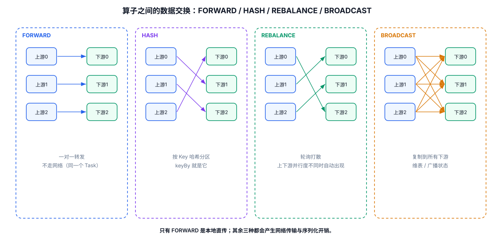
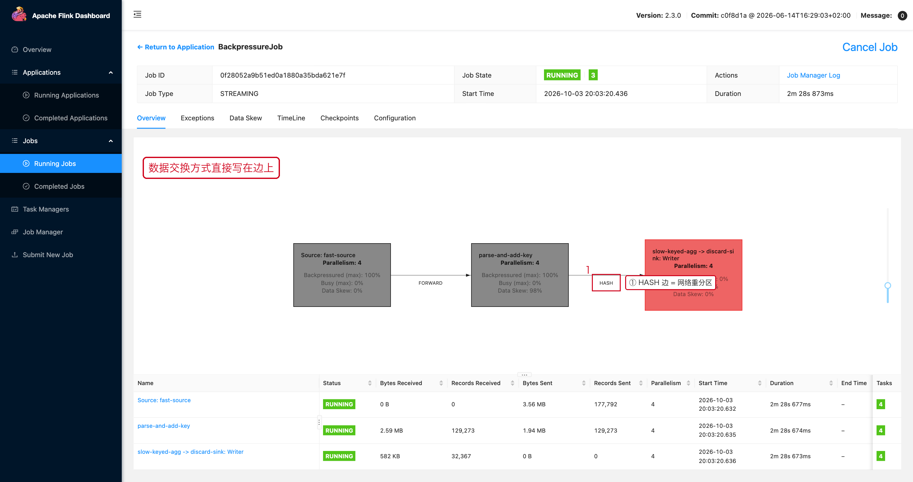

# 03-数据交换与 Network Shuffle



## 1. 为什么 Flink 需要 Shuffle

并行流处理中，上游数据必须被分配给下游 Subtask。

例如：

```text
Source Subtask 0 ─┐
Source Subtask 1 ─┼→ KeyBy → Downstream Subtasks
Source Subtask 2 ─┤
Source Subtask 3 ─┘
```

## 2. Forward 与 Redistributing

### Forward

上游 Subtask 的数据直接发给对应的下游 Subtask。

### Redistributing

数据需要重新分区，例如：

```java
.keyBy(Event::getUserId)
```

或者：

```java
.rebalance()
```

## 3. KeyBy 的核心机制

Keyed Stream 会按照 Key 进行分区，使同一个 Key 的事件进入同一个并行实例，从而让 Keyed State 能够本地访问。

Keyed State 还会以 Key Group 作为重新分配的基本单位；Key Group 数量与 Maximum Parallelism 关联。官方 Stateful Stream Processing 文档对此有明确说明：
https://nightlies.apache.org/flink/flink-docs-release-2.3/docs/concepts/stateful-stream-processing/

## 4. 为什么 Shuffle 会影响性能

数据跨 Task 传输时，需要经过 Network Stack。

可能增加：

```text
序列化
→ Network Buffer
→ 网络传输
→ 排队
→ 反序列化
```

如果数据量巨大，Shuffle 本身就可能成为瓶颈。

## 5. 排查思路

```text
吞吐下降
↓
Operator 是否被 Chain
↓
是否存在大量数据交换
↓
Shuffle 前后的 Records In/Out 是否匹配
↓
Network Buffer 是否紧张
↓
是否产生 BackPressure
```

## 6. 工程上的启示

不要随意增加：

```java
.map(...)
.filter(...)
.keyBy(...)
.rebalance()
```

而应先理解这些 API 是否产生新的执行边界，以及数据是否需要重新分区。

---

## 7. 配套 Web UI 证据



JobGraph 的边上直接写着 HASH / FORWARD

