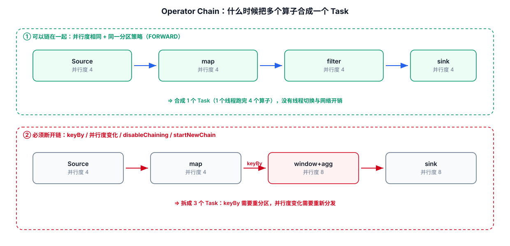

# 04-Operator Chain



## 1. Operator Chain 解决什么问题

如果每一个 Operator 都独立成为 Task，那么：

```text
Operator A
↓ thread handoff
Operator B
↓ thread handoff
Operator C
```

会有更多线程切换和数据传输开销。

Operator Chaining 允许满足条件的相邻 Operator 在同一个 Task 中执行。

## 2. 一个直观例子

```java
stream
    .map(...)
    .filter(...)
    .flatMap(...);
```

可能形成：

```text
Task 1
└── map → filter → flatMap
```

而不是三个独立 Task。

Flink 官方架构文档指出，Operator Chaining 可以降低线程间交接与 Buffer 开销，并提高吞吐、降低延迟：
https://nightlies.apache.org/flink/flink-docs-release-2.3/docs/concepts/flink-architecture/

## 3. 什么时候 Chain 会被打断

典型情况：

- 数据需要重新分区
- 并行度不兼容
- 显式禁止 chaining
- 某些算子的实现边界

## 4. 手工调 Chain

```java
DataStream<Event> stream = ...;

// 仅在有明确理由时使用。
stream
    .map(...)
    .disableChaining();
```

不要把 `disableChaining()` 当成通用性能优化手段。

## 5. 为什么拆 Chain 有时有用

例如：

```text
Source
 → CPU-heavy Process
 → Sink
```

如果希望独立观察或调度某个环节，可能需要拆分 Chain。

但拆分后可能增加线程/网络开销，因此需要用 Web UI 和 Metrics 验证，而不是凭感觉操作。

---

## 6. 配套 Web UI 证据


被链在一起的算子会显示成 “A -> B” 一个节点

