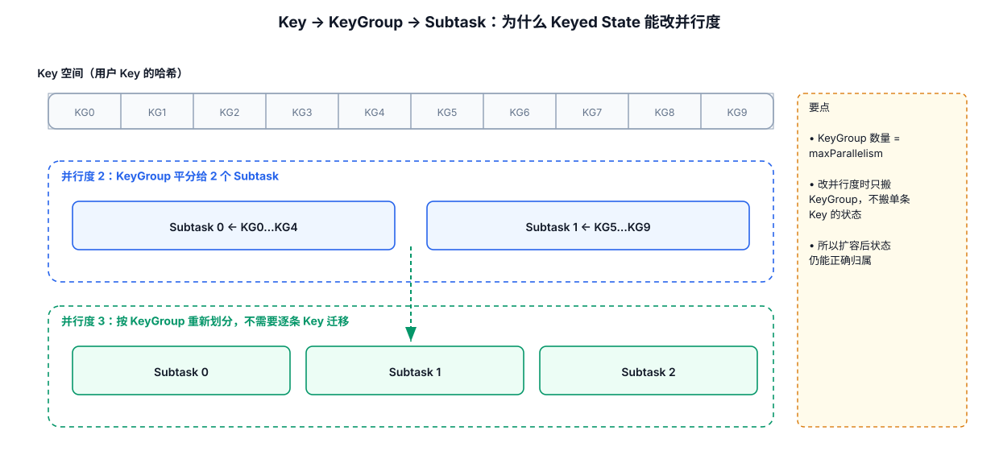
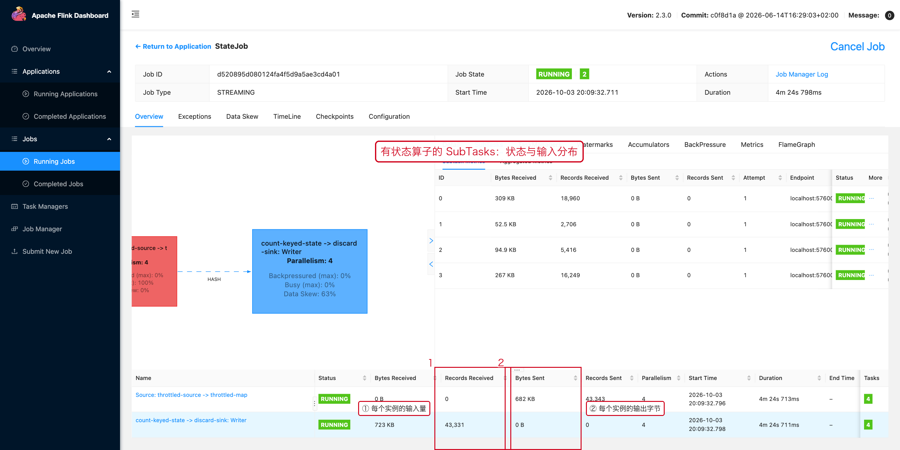

# 05-State与 Key Group



## 1. 为什么 State 必须和 Key 对齐

对于：

```java
stream
    .keyBy(Event::getUserId)
    .process(...);
```

同一个 `userId` 的事件必须进入负责该 Key 的同一个并行实例，否则：

```text
Event A → Subtask 1
Event B → Subtask 2
```

状态会被拆散，Keyed State 无法保证本地一致访问。

## 2. Key Group 是什么

可以把 Key Group 理解成：

```text
Keyed State 重新分布时的基本搬运单位
```

一个 Key 首先映射到某个 Key Group，再由当前并行度决定该 Key Group 归属于哪个 Subtask。

## 3. 为什么 Maximum Parallelism 重要

Key Group 数量与 Maximum Parallelism 相关。

因此：

```text
Maximum Parallelism
影响 Key Group 数量
影响 State 如何重新分配
```

生产环境不要随意修改一个已有有状态任务的 Maximum Parallelism 后再直接恢复状态；需要结合 Savepoint / State Compatibility 评估。

## 4. State 重新分配

任务从：

```text
parallelism = 4
```

扩展到：

```text
parallelism = 8
```

Flink 不是把旧 Subtask 的 State 简单复制成两份，而是按照 Key Group 重新分配 State。

这也是为什么 Keyed State 可以支持并行度调整。

## 5. 与数据倾斜的关系

如果热点 Key 很集中：

```text
普通 Key → 分散在多个 Key Group
热点 Key → 集中在少数 Key Group
```

最终仍可能表现为少数 Subtask 特别忙。

增加 Parallelism 不一定消除单个热点 Key，因为同一个 Key 不能同时分散到多个 Keyed Subtask。

---

## 6. 配套 Web UI 证据



SubTasks 页面看每个实例的状态与输入

