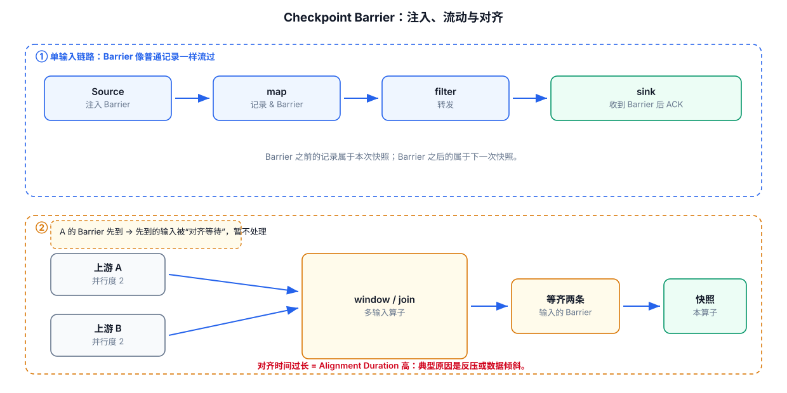
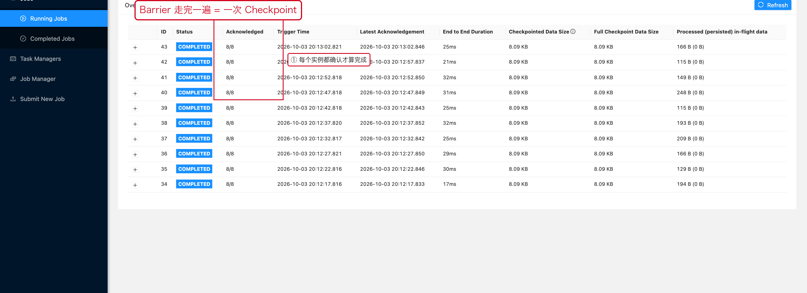

# 06-Checkpoint与 Barrier



## 1. Checkpoint 的核心目标

Checkpoint 保存两类一致性信息：

```text
Operator State
+
输入流位置 / Source Position
```

恢复时：

```text
恢复 State
+
从对应输入位置继续处理
```

从而实现一致性恢复。官方 Checkpoint 文档明确将 Checkpoint 描述为恢复状态与对应流位置的机制：
https://nightlies.apache.org/flink/flink-docs-release-2.3/docs/ops/state/checkpoints/

## 2. Barrier 是什么

Barrier 可以理解为插入数据流中的“Checkpoint 标记”。

```text
数据1
数据2
Barrier #100
数据3
数据4
```

Barrier 会沿着数据流传播，用于定义某个一致性快照的边界。

## 3. 多输入 Operator 为什么复杂

假设一个 Operator 有：

```text
Input A ─┐
         ├→ Operator
Input B ─┘
```

不同输入收到 Barrier 的时间可能不同。

Aligned Checkpoint 的核心就是等待输入侧的 Barrier 对齐。

## 4. Alignment 为什么会变慢

如果：

```text
Input A：Barrier 已到
Input B：Barrier 很晚才到
```

Operator 就可能等待 B。

这就是 Alignment Duration 高的重要原因之一。

当作业存在 BackPressure 时，Barrier 传播也可能被拖慢。官方文档对此有明确说明：
https://nightlies.apache.org/flink/flink-docs-release-2.3/docs/ops/state/checkpointing_under_backpressure/

## 5. Unaligned Checkpoint

Unaligned Checkpoint 会把 in-flight data 一起纳入快照，使 Barrier 可以更快越过缓存中的数据。

适合关注点：

```text
Checkpoint 长时间被 BackPressure 阻塞
```

但如果真正瓶颈是 State Storage IO，则 Unaligned 并不能解决根因，反而可能增加需要持久化的数据量。

---

## 6. 配套 Web UI 证据



所有实例都 ACK 才算一次 Checkpoint 完成

