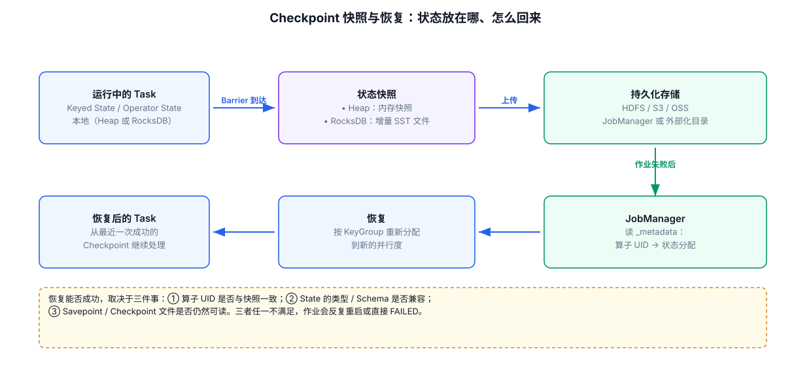

# 07-Checkpoint状态快照与恢复



## 1. Checkpoint 保存什么

核心是：

```text
各 Operator 的 State Snapshot
+
Source Position
+
Checkpoint Metadata
```

具体的 State 如何落盘由 State Backend / Checkpoint Storage 共同决定。

## 2. State Backend 与 Checkpoint Storage 不要混为一谈

### State Backend

关注：

```text
运行时 State 如何组织、访问、管理
```

### Checkpoint Storage

关注：

```text
Checkpoint Snapshot 最终保存到哪里
```

例如常见组合可能是：

```text
EmbeddedRocksDBStateBackend
+
FileSystemCheckpointStorage
```

## 3. Incremental Checkpoint

大 State 场景下，如果每次都把全部 State 完整上传，Checkpoint 成本可能很高。

增量 Checkpoint 的思路是复用已有快照中的不变文件，只记录新增或变化部分。

因此：

```text
Full Checkpoint Size
≠
每一次真正新上传的数据量
```

## 4. 恢复流程

```text
Job 失败
 ↓
找到最近成功 Checkpoint
 ↓
恢复 Operator State
 ↓
恢复 Source Position
 ↓
重新部署 Operator
 ↓
从对应位置继续处理
```

## 5. Checkpoint 间隔的权衡

Checkpoint 越频繁：

```text
故障恢复时回放数据更少
但
运行期间 Checkpoint 开销更高
```

Checkpoint 越稀疏：

```text
运行期开销低
但
失败恢复时需要回放更多数据
```

Flink 官方 State 文档也将 Checkpoint Interval 描述为执行期容错开销与恢复时间之间的权衡：
https://nightlies.apache.org/flink/flink-docs-release-2.3/docs/concepts/stateful-stream-processing/

---

## 6. 配套 Web UI 证据


从 Savepoint 恢复后的作业

