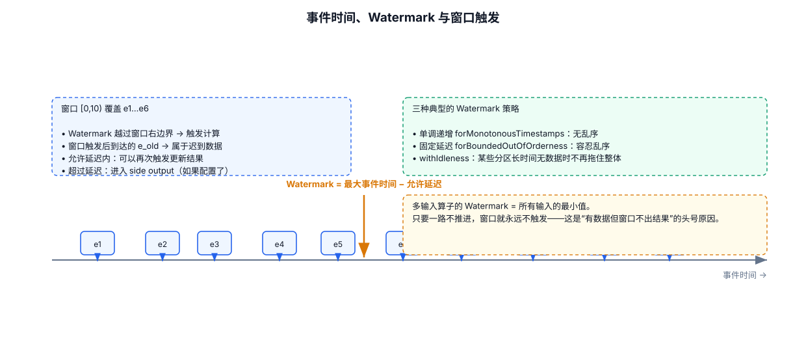
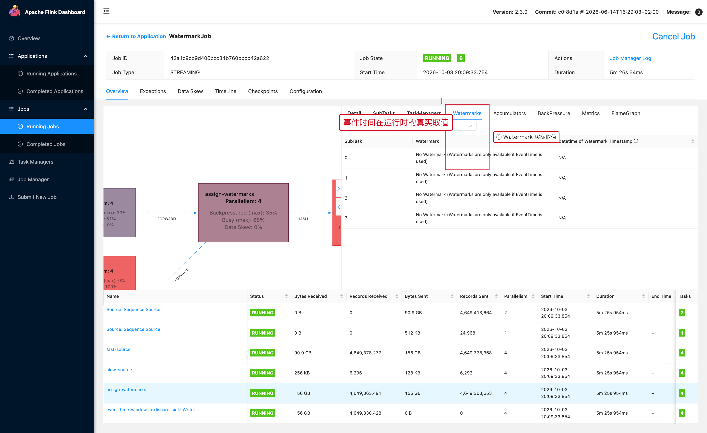

# 08-Watermark与 Event Time



## 1. Event Time

Event Time 是事件实际发生的时间，而不是 Flink 处理这条消息的机器时间。

例如：

```text
事件发生：10:00:01
Kafka 到达：10:00:08
Flink 处理：10:00:09
```

Event Time = `10:00:01`。

## 2. 为什么需要 Watermark

流数据可能乱序：

```text
10:00:05
10:00:03
10:00:07
10:00:04
```

Flink 需要一个“事件时间进展”的信号，判断某个时间点之前的数据大体已经到齐。

Watermark 就承担这个作用。

官方文档明确指出：Event Time 的推进依赖 Watermark，而实时场景由于无法无限等待未来数据，因此不可避免存在等待延迟与迟到数据之间的权衡。

## 3. Bounded Out-of-Orderness

例如：

```java
WatermarkStrategy<Event> strategy =
        WatermarkStrategy
            // 1. 最多允许事件乱序 5 秒
            .<Event>forBoundedOutOfOrderness(Duration.ofSeconds(5))
            // 2. 从事件中取出事件时间
            .withTimestampAssigner(
                (event, recordTimestamp) -> event.getEventTime()
            );
```

核心思想：

```text
当前看到的最大事件时间
-
允许乱序时间
=
Watermark 近似推进位置
```

## 4. 为什么最小 Watermark 会拖住整个算子

一个 Task 从多个输入接收 Watermark 时，通常需要以最慢输入推进，因此：

```text
Input A = 10:00:10
Input B = 09:59:00

Task Watermark ≈ min(A, B)
             = 09:59:00
```

因此某个落后输入可能拖住整个窗口。

Flink 官方调试文档对 `currentInputWatermark` 的定义就是取上游 Watermark 的最低值。
https://nightlies.apache.org/flink/flink-docs-release-2.3/docs/ops/debugging/debugging_event_time/

## 5. Idle Source

如果某个分区长期没有数据，但系统把它当作活跃输入，就可能造成 Watermark 长时间不推进。

因此要理解：

```text
无数据
≠
事件时间已经推进
```

需要根据 Source 特征考虑 idle timeout。

## 6. Watermark 与 Window

Event-Time Window 通常依赖 Watermark 触发窗口计算。

例如：

```text
Window：[10:00, 10:05)
Watermark = 10:05
```

意味着系统认为该窗口已经到了可以触发计算的时间点。

窗口、Trigger、Allowed Lateness 是三个不同概念，不要混为一谈。

---

## 7. 配套 Web UI 证据



运行时的 Watermark 实际取值

