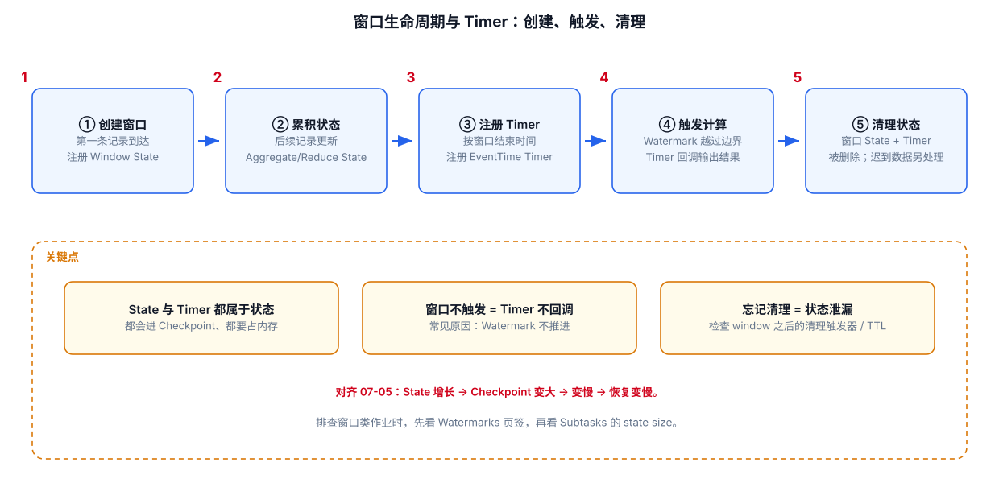

# 09-Window生命周期与 Timer



## 1. Window 不是一个静态桶

时间窗口大致经历：

官方窗口文档明确说明，基于时间的窗口会在 watermark 超过窗口结束时间加上 Allowed Lateness 后被完全移除。
https://nightlies.apache.org/flink/flink-docs-release-2.3/docs/dev/datastream/operators/windows/

## 2. Window Assigner

负责回答：

> 这条数据属于哪个窗口？

常见：

```text
Tumbling
Sliding
Session
Global
```

## 3. Trigger

负责回答：

> 现在是否应该计算这个窗口？

Event-Time Window 默认会根据 Watermark 触发。

因此：

```text
Window Assigning
≠
Trigger
```

## 4. ProcessWindowFunction

负责回答：

> 窗口真正触发后，怎么计算？

如果只是简单聚合，优先考虑增量聚合，而不是把整个窗口元素保存下来。

## 5. Timer

Keyed ProcessFunction 可以注册：

```text
Event-Time Timer
Processing-Time Timer
```

例如：

```java
ctx.timerService().registerEventTimeTimer(timestamp);
```

其含义是：

```text
当 Event Time / Watermark 推进到指定时间后
调用 onTimer()
```

Timer 常用于：

- 超时检测
- Session
- 延迟处理
- 状态清理
- 自定义时间窗口

## 6. Timer 与 Window 的关系

可以这样理解：

```text
Window
= Flink 帮你封装的一套窗口 + Trigger + State 机制

Timer
= 更底层的“到某个时间执行逻辑”的机制
```

需要高度自定义时间逻辑时，ProcessFunction + Timer 往往比硬套 Window 更直接。

---

## 7. 配套 Web UI 证据


窗口不触发时先看 Watermarks

