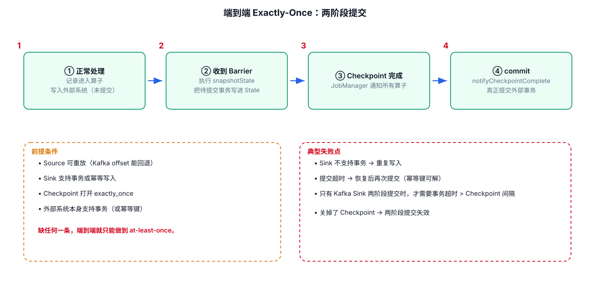

# 10-ExactlyOnce与一致性



## 1. Exactly-Once 到底保证什么

容易产生一个误解：

> Exactly-Once = 整条业务链最终数据库中只会出现一次。

这并不成立。

更准确的理解是：Flink 的状态一致性机制可以让算子状态在故障恢复后表现得像一次一致的处理；但端到端语义还取决于 Source 与 Sink 的能力。

## 2. Processing Semantics

常见概念：

```text
At-Most-Once
At-Least-Once
Exactly-Once
```

### At-Most-Once

最多处理一次，失败后可能丢。

### At-Least-Once

可能重复，但尽量不丢。

### Exactly-Once

在支持相应机制的状态与数据源/数据汇语义下，实现一致的结果。

## 3. 为什么 Source 很重要

恢复时 Flink 需要：

```text
恢复 State
+
回到一致的输入位置
```

如果 Source 根本不能回放历史数据，就无法仅依靠 Flink Checkpoint 完成同样的恢复保证。

## 4. 为什么 Sink 更重要

假设：

```text
Flink 内部 Exactly-Once
```

但 Sink 是普通：

```text
INSERT INTO xxx
```

任务在：

```text
写成功
↓
Flink 尚未记录一致状态
↓
任务崩溃
↓
恢复后再次写
```

就可能产生重复。

因此端到端 Exactly-Once 需要 Sink 具备事务、幂等、Upsert 等相应能力。

## 5. 实际项目中的判断方法

看到“Exactly-Once”时强制问三个问题：

```text
① Source 能不能回放？
② Flink State 是否正确 Checkpoint？
③ Sink 怎么处理重复提交？
```

三个问题都回答清楚，才有资格讨论端到端一致性。

---

## 6. 配套 Web UI 证据


Checkpoint 配置是两阶段提交的前提

