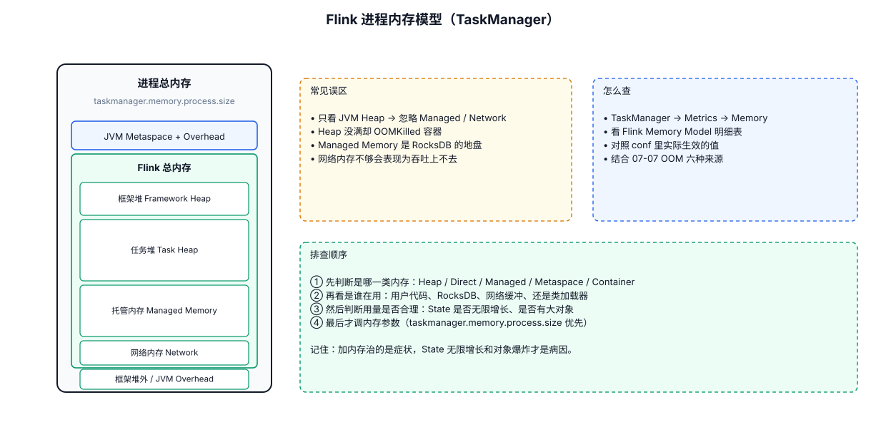
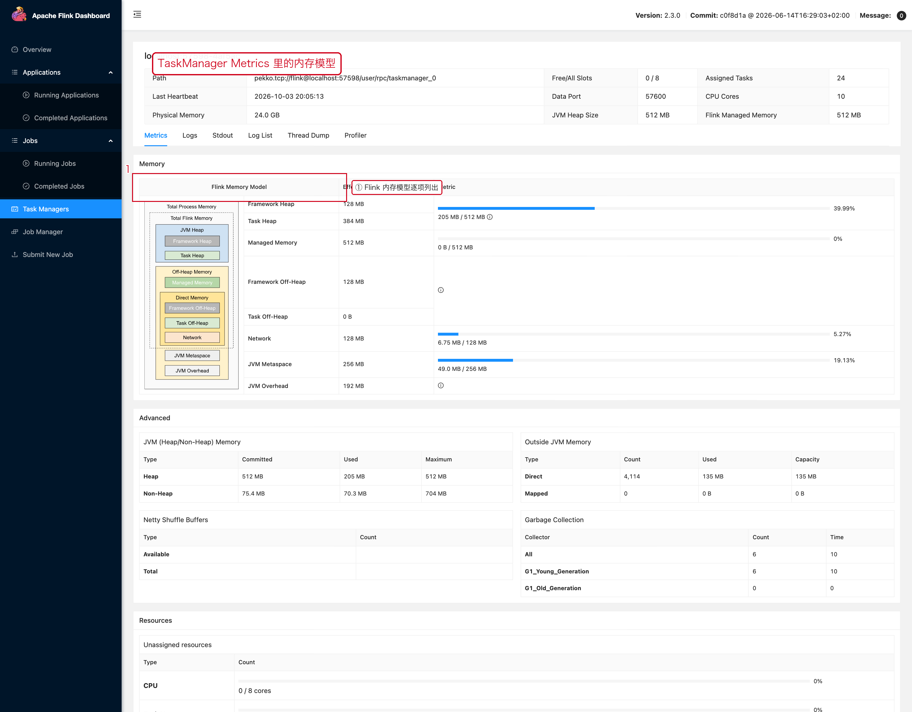

# 11-内存模型与资源模型



## 1. 为什么 Flink 内存问题很容易排查错

因为：

```text
JVM Heap
≠
全部 Flink 内存
```

TaskManager 进程中还可能涉及：

- Framework Memory
- Task Memory
- Managed Memory
- Network Memory
- JVM metaspace / overhead
- Direct / Native Memory

因此看到容器内存接近上限，不等于 Java Heap 快满了。

## 2. TaskManager 资源模型

可以先用这张简化图记：

```text
TaskManager Process
├── JVM Heap
├── Managed Memory
│   └── Batch / State Backend 等用途
├── Network Memory
│   └── Shuffle / Buffer
├── Framework Memory
└── JVM Overhead / Native / Direct
```

具体内存组成和配置以当前版本的 Flink 内存模型为准。生产排查不要只盯 `-Xmx`。

## 3. Managed Memory

Managed Memory 是 Flink 统一管理的一部分内存，部分状态后端和算法会使用它。

Large State 场景下需要同时关注：

```text
State Size
+
Managed Memory
+
Checkpoint IO
```

## 4. Network Memory

Flink 的数据交换需要 Network Buffer。

当网络缓冲不足时，可能出现：

```text
Buffer 不足
↓
数据交换受阻
↓
上游等待
↓
BackPressure
```

因此 Network Memory 与 BackPressure、Checkpoint Alignment 也存在关系。

## 5. 为什么“加内存”有时没用

例如真正原因是：

```text
无界 ListState
```

增加容器内存只是允许它多跑一段时间。

又例如：

```text
网络 Buffer 不足
```

单纯提高 Heap 可能没有直接作用。

## 6. 排查路径

```text
OOM / Container Killed
↓
确认是 JVM Heap / Native / Container Limit
↓
看 State
↓
看 Managed Memory
↓
看 Network Memory
↓
看外部缓存 / 第三方客户端
↓
最后调整资源
```

---

## 7. 配套 Web UI 证据



TaskManager Metrics 里的内存明细

