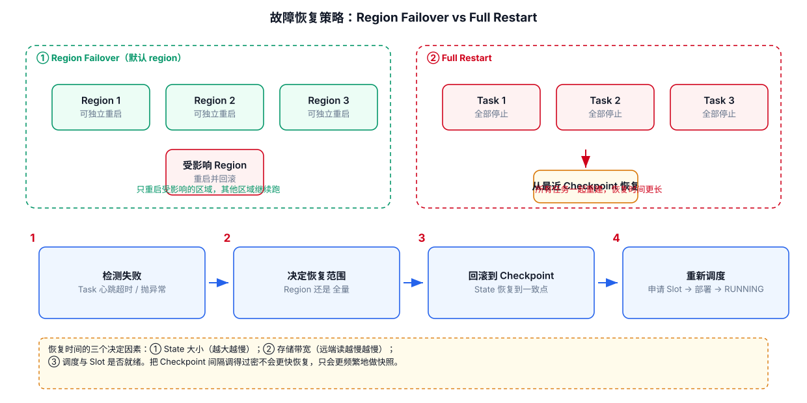
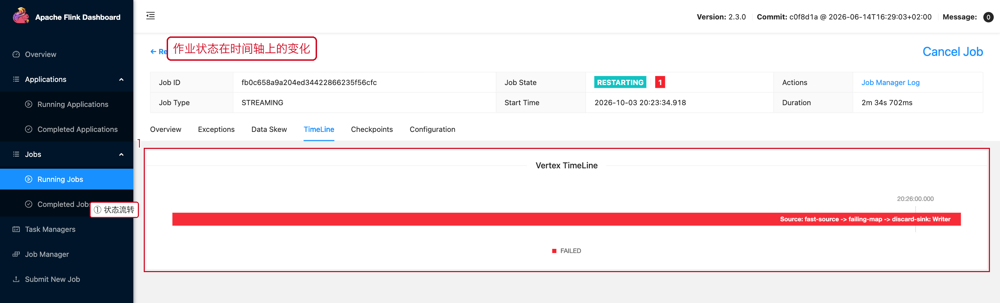

# 12-故障恢复与状态一致性



## 1. Recovery 的核心

Flink 的恢复不是简单：

```text
程序重新启动
```

而是：

```text
重新部署执行图
+
恢复 State
+
恢复输入位置
+
重新处理未完成的数据
```

## 2. 为什么 Checkpoint 能恢复

Checkpoint 是分布式快照。

它把：

```text
不同 Operator 的状态
+
输入流进度
```

关联到同一个一致的时间点。

因此恢复时不会把一个 Operator 恢复到“10:00”，另一个恢复到“10:05”，造成状态和输入不一致。

## 3. Failover

出现局部故障时，Flink 可以根据 Failover Strategy 决定恢复范围。

理解为：

```text
小故障
→ 尽量恢复较小范围

大范围故障
→ 可能恢复更大的任务区域
```

实际恢复范围受执行图、Region、部署方式和配置影响。

## 4. 恢复为什么可能慢

主要组成：

```text
重新分配资源
+
部署 Task
+
下载 / 读取 State
+
恢复 State
+
Source 回放
+
重新追赶积压
```

因此一个任务“恢复慢”不一定是 Flink 启动慢，可能是 State 恢复和历史数据追赶慢。

## 5. 与业务 SLA 的关系

恢复设计至少要同时考虑：

```text
RTO：多久恢复服务
RPO：最多允许丢失多少数据
```

Checkpoint Interval、State Size、恢复资源、Source Replay 能力都会影响实际恢复行为。

## 6. 生产设计原则

```text
Checkpoint 是恢复基础
Savepoint 是主动运维工具
Sink 幂等 / 事务是端到端一致性的最后一环
State Size 决定恢复成本
资源冗余决定故障后追赶速度
```

---

## 7. 配套 Web UI 证据



TimeLine 页签把状态流转摊在时间轴上

