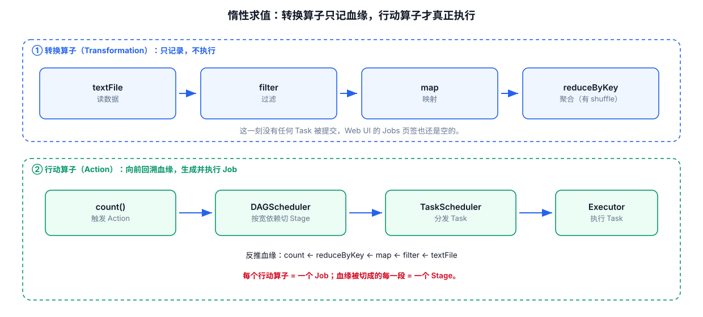
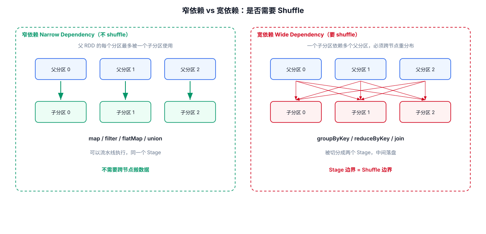

# 03 · RDD 版转换算子（Transformation）






## 算子速查表

| 算子 | 作用 | 是否 shuffle |
|---|---|---|
| map | 一对一映射，逐元素处理 | 否 |
| flatMap | 一对多映射，返回集合并拆分 | 否 |
| groupBy | 按自定义规则分组 | **是** |
| filter | 按条件过滤元素 | 否 |
| distinct | 去重 | **是** |
| sortBy | 按函数结果全局排序 | **是** |
| mapValues | 只对 KV 对的 value 操作 | 否 |
| groupByKey | 按键分组（全量 shuffle） | **是** |
| reduceByKey | 按键聚合（先局部后全局） | **是** |
| sortByKey | 按键排序 | **是** |
| mapPartitions | 按分区操作，一次处理一个分区的数据 | 否 |
| mapPartitionsWithIndex | 带分区号的 mapPartitions | 否 |
| join / leftOuterJoin | 两个 KV RDD 按键连接 | **是** |
| coalesce | 减少分区（尽量不 shuffle） | 否 |
| repartition | 重分区（可增可减，shuffle） | **是** |
| partitionBy | 按指定分区器重新分区 | **是** |
| aggregateByKey | 分区内 + 分区间两段聚合（带初始值） | **是** |
| combineByKey | 最底层的按键聚合算子 | **是** |

## 3.1 map 映射

> 对应源码：[Spark0201_转换算子_Map映射.java](../src/main/java/com/Sparkcore/Spark0201_转换算子_Map映射.java)

**作用**：对 RDD 中每个元素应用函数，一一映射，输入输出元素个数相同。

### lambda 表达式的 4 种写法（源码笔记）

```java
JavaRDD<Integer> numbers = sc.parallelize(Arrays.asList(1, 2, 3, 4));

// 写法1：单个参数的 lambda 表达式
JavaRDD<Integer> Numbers1 = numbers.map(x -> x + x);

// 写法2：多个参数（演示语法，实际 map 只有一个参数）
// JavaRDD<Integer> Numbers2 = numbers.map((x, y) -> x * y);

// 写法3：带有类型声明的参数
JavaRDD<Integer> Numbers3 = numbers.map((Integer x) -> x / 2);

// 写法4：具有复杂逻辑的 lambda 表达式
// JavaRDD<Integer> Numbers4 = numbers.map(x -> {
//     int sum = x + 1;
//     return sum * 2;
// });
```

> lambda 语法：`参数列表 -> 主体`，参数列表类似形参，主体可以是表达式或语句块。

### DataSet 上的 map（需要 Encoder）

```java
// Dataset/DataFrame 的 map 必须指定 Encoder，用于把返回对象编码成 Spark 可处理的数据格式
Encoder<String> stringEncoder = Encoders.STRING();

Dataset<String> resultDF = df.map(
        (MapFunction<Row, String>) row -> "Value: " + row.getString(0),
        stringEncoder
);
// MapFunction：接受一个 Row 作为输入，返回一个字符串
// stringEncoder：将函数返回的字符串编码成 Spark 可以处理的数据格式
```

> ⚠️ **源码问题**：`Spark0201` 中 `Dataset<Row> df =;`（缺少初始化值）、`numbers.map((x, y) -> ...)`（map 只接受单参函数）属于未完成的伪代码，**该文件当前不能编译**，以上代码块已按可运行的形态整理。真正的用法参考：`numbers.map(x -> x + x).collect().forEach(System.out::println);`

## 3.2 flatMap

> 对应源码：[Spark0202_转换算子_flapMap.java](../src/main/java/com/Sparkcore/Spark0202_转换算子_flapMap.java)

**作用**：与 map 相同的是都会逐元素应用函数；
**区别**在于 flatMap 的返回值是一个**集合**，并且会把集合中的每个元素**拆分**出来放到新的 RDD 中（**一对多**）。

以下是 WordCount 中典型的 flatMap 用法：

```java
// 导入数据
JavaRDD<String> lineRDD = sc.textFile("input");

JavaRDD<String> wordRDD = lineRDD.flatMap(line -> Arrays.asList(line.split(" ")).iterator());
// flatMap 返回一个集合（单词列表），Spark 会把集合中的每个单词拆开放入新 RDD

// 对比 map 的写法（得到的是"行的数组"，不是拆开的单词）：
// JavaRDD<String[]> wordRDD2 = lineRDD.map(line -> line.split(" "));
```

> **map vs flatMap**：map 输出一个元素（一对一）；flatMap 输出零到多个元素（一对多），常用于分词、拆行等场景。

## 3.3 groupBy 分组

> 对应源码：[Spark0203_转换算子_groupBy分组.java](../src/main/java/com/Sparkcore/Spark0203_转换算子_groupBy分组.java)

**作用**：按自定义函数返回的分组标记对元素分组，结果是一个 `JavaPairRDD<K, Iterable<V>>`，key 为分组标记，value 为同组元素的集合。

```java
package com.Sparkcore;

import org.apache.spark.SparkConf;
import org.apache.spark.api.java.JavaPairRDD;
import org.apache.spark.api.java.JavaRDD;
import org.apache.spark.api.java.JavaSparkContext;
import org.apache.spark.api.java.function.Function;

import java.util.Arrays;

// groupBy 会存在 shuffle 过程
public class Spark0203_转换算子_groupBy分组
{
    public static void main(String[] args)
    {
        SparkConf conf = new SparkConf().setMaster("local[*]").setAppName("sparkCore");
        JavaSparkContext sc = new JavaSparkContext(conf);

        JavaRDD<Integer> integerJavaRDD = sc.parallelize(Arrays.asList(1, 2, 3, 4), 2);

        // 泛型为分组标记的类型：按奇偶分组（1、3 一组，2、4 一组）
        JavaPairRDD<Integer, Iterable<Integer>> groupByRDD = integerJavaRDD.groupBy(new Function<Integer, Integer>()
        {
            @Override
            public Integer call(Integer v1) throws Exception
            {
                return v1 % 2;
            }
        });
        groupByRDD.collect().forEach(System.out::println);

        // 分组标记类型可以任意修改：按是否偶数分组（Boolean 类型）
        JavaPairRDD<Boolean, Iterable<Integer>> groupByRDD1 = integerJavaRDD.groupBy(new Function<Integer, Boolean>() {
            @Override
            public Boolean call(Integer v1) throws Exception {
                return v1 % 2 == 0;
            }
        });
        groupByRDD1.collect().forEach(System.out::println);
        // collect：将数据收集到 Driver 端，形成一个列表，forEach 对列表中的每个元素调用 println 方法

        sc.stop();
    }
}
```

**运行结果（示意）**：
```
(0,[2, 4])
(1,[1, 3])
(true,[2, 4])
(false,[1, 3])
```

> ⚠️ **注意**：groupBy 涉及 **shuffle**（数据跨节点重新分配），分组结果在分布式环境下是无序的，分区间顺序不保证。

## 3.4 filter 过滤

> 对应源码：[Spark0204_转换算子_filter过滤.java](../src/main/java/com/Sparkcore/Spark0204_转换算子_filter过滤.java)

**作用**：根据指定条件筛选元素，返回新数据集，只保留函数返回 `true` 的元素。

```java
package com.Sparkcore;

import org.apache.spark.api.java.JavaRDD;
import org.apache.spark.api.java.JavaSparkContext;

import java.util.Arrays;

public class Spark0204_转换算子_filter过滤
{
    public static void main(String[] args) {
        // 初始化 SparkContext
        JavaSparkContext sc = new JavaSparkContext("local", "Filter Example");

        // 创建一个简单的整数 RDD
        JavaRDD<Integer> rdd = sc.parallelize(Arrays.asList(1, 2, 3, 4, 5));

        // 使用 filter 筛选出所有大于 3 的元素
        JavaRDD<Integer> filteredRDD = rdd.filter(x -> x > 3);

        // 收集结果并打印
        System.out.println(filteredRDD.collect()); // 输出 [4, 5]

        sc.close();
    }
}
```

## 3.5 distinct 去重

> 对应源码：[Spark0205_转换算子_distinct去重.java](../src/main/java/com/Sparkcore/Spark0205_转换算子_distinct去重.java)

**作用**：去除 RDD 中的重复元素。

```java
package com.Sparkcore;

import org.apache.spark.SparkConf;
import org.apache.spark.api.java.JavaRDD;
import org.apache.spark.api.java.JavaSparkContext;

import java.util.Arrays;

public class Spark0205_转换算子_distinct去重
{
    public static void main(String[] args)
    {
        SparkConf conf = new SparkConf()
                .setAppName("MyApp")
                .setMaster("local[*]") // 使用所有可用的本地线程
                .set("spark.executor.memory", "4g") // 设置每个 executor 的内存为 4GB
                .set("spark.sql.shuffle.partitions", "2"); // 设置 shuffle 分区数

        JavaSparkContext sc = new JavaSparkContext(conf);
        //创建数组
        JavaRDD<Integer> integerJavaRDD = sc.parallelize(Arrays.asList(1, 2, 3, 4, 5, 6), 2);

        // 底层使用分布式分组去重，所有速度比较慢，但是不会 OOM
        JavaRDD<Integer> distinct = integerJavaRDD.distinct();

        //打印结果
        distinct.collect().forEach(System.out::println);

        sc.stop();
    }
}
```

> **知识点**：distinct 底层通过「分布式分组」去重（先按键分组再取每组一个），涉及 shuffle，因此**速度较慢但不会内存溢出（OOM）**。

## 3.6 sort 排序

> 对应源码：[Spark0206_转换算子_sort排序.java](../src/main/java/com/Sparkcore/Spark0206_转换算子_sort排序.java)


> - 该操作对数据排序；排序前可将数据通过函数 f 处理，之后按 f 的处理结果排序，**默认正序**。
> - 排序后新产生的 RDD 的**分区数与原 RDD 分区数一致**。
> - Spark 的排序结果是**全局有序**。

**sortBy 三个参数**（源码注释整理）：`(1)` 泛型为以谁作为排序标准 `(2)` true 为正序 `(3)` 排序之后的分区个数

```java

JavaRDD<Integer> integerJavaRDD = sc.parallelize(Arrays.asList(5, 8, 1, 11, 20), 2);

// 参数1：按元素自身排序（也可传 Function 自定义排序键）
// 参数2：true 为正序（升序）
// 参数3：排序后的分区个数
JavaRDD<Integer> sortByRDD = integerJavaRDD.sortBy(v1 -> v1, true, 2);
sortByRDD.collect().forEach(System.out::println); // 输出 1, 5, 8, 11, 20
```

## 3.7 mapValues

> 对应源码：[Spark0207_转换算子_mapVaules.java](../src/main/java/com/Sparkcore/Spark0207_转换算子_mapVaules.java)

**作用**：仅对 KV 对（`JavaPairRDD`）中的 **value** 应用函数，**key 保持不变**。相比 `map`（需要同时处理 key 和 value），mapValues 更简洁高效。

```java
// 源码示例：对每个单词的计数加 10
JavaPairRDD<String, Integer> kvRDD = sc.parallelizePairs(Arrays.asList(
        new Tuple2<>("a", 1), new Tuple2<>("b", 2), new Tuple2<>("c", 3)));

JavaPairRDD<String, Integer> result = kvRDD.mapValues(v -> v + 10);
// 结果：(a,11) (b,12) (c,13)，key 不变，只改 value
```

## 3.8 groupByKey

> 对应源码：[Spark0208_转换算子_groupByKey.java](../src/main/java/com/Sparkcore/Spark0208_转换算子_groupByKey.java)


**作用**：按键分组，把相同 key 的所有 value 聚合到一个集合中，返回 `JavaPairRDD<K, Iterable<V>>`。

```java
// 源码示例：按键分组
JavaPairRDD<String, Integer> kvRDD = sc.parallelizePairs(Arrays.asList(
        new Tuple2<>("a", 1), new Tuple2<>("b", 2), new Tuple2<>("a", 3)));

JavaPairRDD<String, Iterable<Integer>> grouped = kvRDD.groupByKey();
// 结果：(a,[1, 3]) (b,[2])
```

> ⚠️ **注意**：groupByKey 会把**所有**数据通过网络进行全量 shuffle（不先在分区内聚合），数据量大时性能较差。能用 `reduceByKey` 的场景优先用 reduceByKey。

## 3.9 reduceByKey

> 对应源码：[Spark0209_转换算子_reduceByKey.java](../src/main/java/com/Sparkcore/Spark0209_转换算子_reduceByKey.java)


**作用**：按键聚合，对相同 key 的 value 应用归约函数（如求和、求最大值）。**先在各分区内局部聚合，再 shuffle 全局聚合**，传输数据量远小于 groupByKey，性能更好。

```java
// 源码示例：按键求和（WordCount 的核心算子）
JavaPairRDD<String, Integer> kvRDD = sc.parallelizePairs(Arrays.asList(
        new Tuple2<>("hello", 1), new Tuple2<>("world", 1), new Tuple2<>("hello", 1)));

JavaPairRDD<String, Integer> result = kvRDD.reduceByKey(Integer::sum);
// 结果：(hello,2) (world,1)
```

> **groupByKey vs reduceByKey**：两者都会 shuffle，但 reduceByKey 会先做**分区内聚合（map 端预聚合）**再 shuffle，只传输聚合结果；groupByKey 直接传输全部数据。同一份数据量下 reduceByKey 网络开销更小。

## 3.10 sortByKey

> 对应源码：[Spark0210_转换算子_sortByKey.java](../src/main/java/com/Sparkcore/Spark0210_转换算子_sortByKey.java)


**作用**：对 KV 对的 RDD 按照 **key** 排序，返回排序后的 `JavaPairRDD`。

```java
// 源码示例：按键升序排序
JavaPairRDD<String, Integer> kvRDD = sc.parallelizePairs(Arrays.asList(
        new Tuple2<>("b", 2), new Tuple2<>("a", 1), new Tuple2<>("c", 3)));

JavaPairRDD<String, Integer> sorted = kvRDD.sortByKey(true); // true 为升序
// 结果：(a,1) (b,2) (c,3)
```

## 3.11 mapPartitions / mapPartitionsWithIndex（按分区操作）


**作用**：与 `map` 都是逐元素处理，但粒度不同——`mapPartitions` 是**一次处理一个分区的整个数据**（拿到该分区的 `Iterator`），而不是一个元素一次函数调用。

```java
JavaRDD<Integer> rdd = sc.parallelize(Arrays.asList(1, 2, 3, 4, 5, 6), 3);

// mapPartitions：一次处理一个分区的数据（lambda 的参数是 Iterator）
JavaRDD<Integer> result = rdd.mapPartitions(iter -> {
    List<Integer> list = new ArrayList<>();
    while (iter.hasNext()) {
        list.add(iter.next() * 10);   // 分区内所有元素都乘 10
    }
    return list.iterator();
});

// mapPartitionsWithIndex：多一个分区号参数，方便知道当前处理的是第几个分区
JavaRDD<String> result2 = rdd.mapPartitionsWithIndex((index, iter) -> {
    List<String> list = new ArrayList<>();
    while (iter.hasNext()) {
        list.add("分区" + index + "：" + iter.next());
    }
    return list.iterator();
}, true);  // 最后一个参数 preservesPartitioning：是否保留原分区器（通常 true）
```

> **map vs mapPartitions**：
> - `map`：每个元素一次函数调用，函数开销被放大 N 次。
> - `mapPartitions`：每个分区一次函数调用，可在函数内做**一次性初始化**（如建立数据库连接、加载配置），然后批量处理分区内所有元素。
> - **性能意义**：需要在函数里创建昂贵资源（数据库连接、网络连接）时，用 `mapPartitions` 能把这些资源**按分区复用**，而不是每个元素建一次，性能提升明显（同 04 章的 `foreachPartition`）。
> - **注意**：若一次要把整个分区数据加载进内存（如 `iter` 全部 `collect`），大数据分区可能 OOM。

---

## 3.12 join 系列（连接两个 KV RDD）


**作用**：对两个 `JavaPairRDD<K, V>` 按键做连接，类似 SQL 的 JOIN。常用三种：

| 算子 | 相当于 SQL | 说明 |
|---|---|---|
| `join` | INNER JOIN | 只保留两边都存在的 key |
| `leftOuterJoin` | LEFT JOIN | 保留左边全部 key，右边没有则为 `Optional.empty` |
| `rightOuterJoin` | RIGHT JOIN | 保留右边全部 key |
| `fullOuterJoin` | FULL JOIN | 两边都保留 |
| `cogroup` | 全外连接的分组形式 | 返回 `(K, (Iterable<V1>, Iterable<V2>))` |

```java
JavaPairRDD<String, Integer> rdd1 = sc.parallelizePairs(Arrays.asList(
        new Tuple2<>("a", 1), new Tuple2<>("b", 2), new Tuple2<>("c", 3)));

JavaPairRDD<String, String> rdd2 = sc.parallelizePairs(Arrays.asList(
        new Tuple2<>("a", "x"), new Tuple2<>("b", "y"), new Tuple2<>("d", "z")));

// inner join：只保留两边都有的 key（a、b）
JavaPairRDD<String, Tuple2<Integer, String>> joined = rdd1.join(rdd2);
// 结果：(a,(1,x)) (b,(2,y))

// leftOuterJoin：保留左边全部 key（a、b、c），右边缺的用 Optional.empty
JavaPairRDD<String, Tuple2<Integer, Optional<String>>> left = rdd1.leftOuterJoin(rdd2);
// 结果：(a,(1,Optional[x])) (b,(2,Optional[y])) (c,(3,Optional.empty))

// cogroup：把两边相同 key 的 value 都放进集合（不配对，只是分组）
JavaPairRDD<String, Tuple2<Iterable<Integer>, Iterable<String>>> cg = rdd1.cogroup(rdd2);
// 结果：(a,([1],[x])) (b,([2],[y])) (c,([3],[])) (d,([],[z]))
```

> **知识点**：
> - join 系列都涉及 **shuffle**（按键重新分配数据），是分布式计算中最昂贵的操作之一。
> - `leftOuterJoin` 右边缺失值用 `Optional` 包装（Java API 特有），需要 `if (optional.isPresent())` 判断。
> - `cogroup` 是 join 的底层实现，join 本质就是 cogroup 后再配对。

---

## 3.13 coalesce / repartition / partitionBy（分区调整）


**作用**：调整 RDD 的分区数或分区方式。三者区别很关键：

| 算子 | 能否增加分区 | 是否 shuffle | 说明 |
|---|---|---|---|
| `coalesce(n)` | **只能减少** | **默认不 shuffle** | 合并相邻分区，速度快 |
| `repartition(n)` | 增/减都行 | **一定 shuffle** | 底层就是 `coalesce(n, true)` |
| `partitionBy(p)` | 增/减都行 | **一定 shuffle** | 按指定分区器重分区，仅 KV RDD 可用 |

```java
JavaRDD<Integer> rdd = sc.parallelize(Arrays.asList(1, 2, 3, 4, 5, 6), 6);

// coalesce：减少分区（6 个分区合并为 2 个，不 shuffle，只合并相邻分区）
JavaRDD<Integer> coalesced = rdd.coalesce(2);

// repartition：重新分区（可增可减，会 shuffle，数据均匀打散）
JavaRDD<Integer> repartitioned = rdd.repartition(8);

// partitionBy：按 key 的哈希值分区（只有 KV RDD 有这个方法）
JavaPairRDD<String, Integer> kvRDD = sc.parallelizePairs(Arrays.asList(
        new Tuple2<>("a", 1), new Tuple2<>("b", 2), new Tuple2<>("c", 3)));
JavaPairRDD<String, Integer> partitioned = kvRDD.partitionBy(new HashPartitioner(3));
// 把所有相同 key 的数据路由到同一个分区
```

> **知识点**：
> - `coalesce` 减少分区时**不 shuffle**（只合并相邻分区），所以快；但如果数据分布不均，合并后可能数据倾斜。
> - `repartition` 会**全量 shuffle**，数据能均匀打散，但开销大。**要均匀减少分区且不在乎开销，用 repartition；只想快速合并减少分区，用 coalesce。**
> - `partitionBy` 常用于 join/groupBy 之前**预分区**，让后续 shuffle 更高效（相同 key 提前聚到同分区）。

---

## 3.14 aggregateByKey / combineByKey（底层按键聚合）


**作用**：这两个是 `reduceByKey` / `groupByKey` 的**底层实现**，提供更精细的控制（可自定义初始值、分区内与分区间用不同逻辑）。

### aggregateByKey：带初始值的两段聚合

`aggregateByKey(零值)(分区内聚合函数, 分区间聚合函数)`——比 reduceByKey 多一个**初始值**，且分区内/分区间可用不同函数：

```java
JavaPairRDD<String, Integer> kvRDD = sc.parallelizePairs(Arrays.asList(
        new Tuple2<>("a", 1), new Tuple2<>("a", 2), new Tuple2<>("b", 3), new Tuple2<>("a", 4)));

// 求每个 key 的最大值
// 参数1：零值（初始值，取最小值）
// 参数2：分区内聚合（当前分区的临时结果 与 新元素 比较取最大）
// 参数3：分区间聚合（两个分区的结果 比较取最大）
JavaPairRDD<String, Integer> maxByKey = kvRDD.aggregateByKey(
        Integer.MIN_VALUE,
        Math::max,     // 分区内：求 max
        Math::max);    // 分区间：求 max
// 结果：(a,4) (b,3)
```

> **理解要点**：`aggregateByKey(零值, seqOp, combOp)` 的三段式——
> 1. `零值`：每个分区先有一个初始值。
> 2. `seqOp`：**分区内**逐个元素与临时结果聚合。
> 3. `combOp`：**分区间**合并各分区的临时结果。

### combineByKey：最底层的按键聚合

`combineByKey` 比 aggregateByKey 更底层——它把「创建初始值」也交给用户，三个函数：

```java
// 求每个 key 的平均值（不能直接用 reduceByKey，因为要同时算 sum 和 count）
JavaPairRDD<String, Integer> kvRDD = sc.parallelizePairs(Arrays.asList(
        new Tuple2<>("a", 1), new Tuple2<>("a", 2), new Tuple2<>("b", 3), new Tuple2<>("b", 5)));

// 三个函数：
// 1. createCombiner：第一个元素如何转成累加器（初始值）→ (值, 1) 表示 sum=值, count=1
// 2. mergeValue：分区内，新元素如何累加到累加器 → sum 相加, count+1
// 3. mergeCombiners：分区间，两个累加器如何合并 → sum 相加, count 相加
JavaPairRDD<String, Tuple2<Integer, Integer>> avgRDD = kvRDD.combineByKey(
        v -> new Tuple2<>(v, 1),                          // createCombiner
        (acc, v) -> new Tuple2<>(acc._1 + v, acc._2 + 1), // mergeValue
        (acc1, acc2) -> new Tuple2<>(acc1._1 + acc2._1, acc1._2 + acc2._2) // mergeCombiners
);

// 结果：(a,(3,2)) (b,(8,2))，即 a 的和=3、个数=2（平均 1.5），b 的和=8、个数=2（平均 4）
```

> **三者关系（聚合算子族谱）**：
> ```
> combineByKey    最底层，三个函数最灵活
>    └── aggregateByKey   加一个"零值"，两个函数（分区内/分区间）
>          └── reduceByKey   零值就是元素本身，分区内外同一函数
>          └── groupByKey    只分组不聚合（不做任何合并）
> ```
>
> **记忆**：`combineByKey`（3 函数，最灵活）→ `aggregateByKey`（零值 + 2 函数）→ `reduceByKey`（1 函数，最常用）。越往上越简单，越往下越能自定义。日常求和/求最大值用 `reduceByKey` 就够，需要自定义初始值或分区内外不同逻辑时才用更底层的。

---

## 常见对比总结

| 对比 | 结论 |
|---|---|
| map vs flatMap | map 一对一；flatMap 一对多（返回集合并拆分） |
| map vs mapPartitions | map 逐元素调用函数；mapPartitions 逐分区调用，可复用昂贵资源（连接） |
| groupByKey vs reduceByKey | 都 shuffle；reduceByKey 有 map 端预聚合，性能更优 |
| mapValues vs map | 处理 KV 时 mapValues 只动 value、不动 key，更简洁 |
| coalesce vs repartition | coalesce 只减不增、尽量不 shuffle；repartition 增/减都行、必 shuffle |
| join vs cogroup | join 按键配对；cogroup 只分组不配对，是 join 的底层 |
| combineByKey → aggregateByKey → reduceByKey | 从最底层（3 函数）到最简单（1 函数），越往下越灵活 |
| 无 shuffle 算子 | map、flatMap、filter、mapValues、mapPartitions |
| 有 shuffle 算子 | groupBy、distinct、sortBy、groupByKey、reduceByKey、sortByKey、join、repartition、partitionBy、aggregateByKey、combineByKey |
