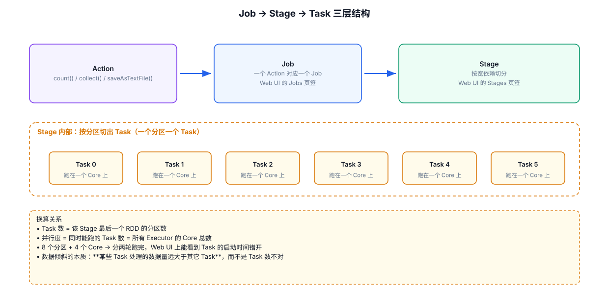

# 04 · RDD 版行动算子（Action）

> **核心概念**：行动算子会**触发真正的计算**（提交 Job）。转换算子只是构建血缘（DAG），只有遇到行动算子才会真正执行。



## 4.0 转换 vs 行动：惰性求值与 Job/Stage/Task

这一节是理解"行动算子"本质的钥匙，也是面试高频题。

### ① 惰性求值（Lazy Evaluation）：为什么行动算子才触发计算

```java
JavaRDD<String> lineRDD = sc.textFile("input");
JavaRDD<String> wordRDD = lineRDD.flatMap(line -> Arrays.asList(line.split(" ")).iterator());
JavaRDD<String> filtered = wordRDD.filter(w -> !w.isEmpty());
// ↑ 上面三行【不会执行任何计算】，只是记录下"要做什么"（构建血缘/DAG）

long count = filtered.count();  // ← 只有这行行动算子，才会真正从头执行上面的转换链
```

> **核心**：转换算子（map/flatMap/filter…）是**惰性**的，只记录计算步骤（构建 DAG，即血缘 lineage），不真正算；**行动算子**才触发 Job 提交，Spark 才真正从头跑一遍整条转换链。

### ② Job → Stage → Task 的层级关系

一个行动算子对应一次完整的执行，内部又分三层：

```
1 个行动算子  →  1 个 Job（作业）
    Job 内部按 shuffle 边界切分为多个 Stage（阶段）
        每个 Stage 内，每个分区一个 Task（任务，真正的最小执行单元）
```

| 层级 | 数量关系 | 切分依据 |
|---|---|---|
| Job | 1 个行动算子 = 1 个 Job | 遇到行动算子就提交一次 |
| Stage | 1 个 Job 含 1~N 个 Stage | **按是否 shuffle 切分**（宽依赖处切一刀） |
| Task | 1 个 Stage 含 1~N 个 Task | 每个分区一个 Task，并行执行 |

```
RDD1 ──map──▶ RDD2 ──filter──▶ RDD3 ──groupByKey──▶ RDD4 ──count()
   [Stage 1：无 shuffle]              │shuffle 切一刀│
                                    [Stage 2：无 shuffle]
```

### ③ 一次行动 = 一次从头计算（引出缓存）

**没有缓存时，每调用一次行动算子，Spark 都会从头重新计算整条血缘链**：

```java
JavaRDD<Integer> rdd = sc.parallelize(Arrays.asList(1,2,3,4,5)).map(x -> x * 2);
rdd.count();   // 第 1 次：从头算一遍 map
rdd.collect(); // 第 2 次：又从头算一遍 map（浪费！）
```

> **解决**：用 `rdd.cache()` 或 `persist()` 把中间结果缓存到内存，后续行动算子直接复用，避免重复计算。缓存是性能优化的核心手段之一。

---

## 算子速查表

| 算子 | 作用 |
|---|---|
| count | 返回 RDD 中元素的个数 |
| collect | 以数组形式返回所有元素 |
| first | 返回 RDD 中第一个元素 |
| take(n) | 返回前 n 个元素组成的数组 |
| takeOrdered(n) | 排序后取前 n 个（全局有序） |
| top(n) | 取最大的 n 个元素 |
| countByKey | 统计每种 key 的个数 |
| countByValue | 统计每种 value 的个数 |
| reduce | 归约所有元素为一个结果 |
| fold | 带初始值的 reduce |
| aggregate | 带初始值 + 分区内外不同函数的归约 |
| max / min | 求最大 / 最小值 |
| isEmpty | 判断 RDD 是否为空 |
| lookup(key) | 按 key 查询（KV 对专用） |
| saveAsTextFile | 以文本形式保存到文件系统 |
| saveAsObjectFile | 序列化成对象保存到文件 |
| foreach | 遍历每个元素执行函数 |
| foreachPartition | 遍历每个分区执行函数 |

## 4.1 count

> 对应源码：[Spark0301_行动算子_count.java](../src/main/java/com/Sparkcore/Spark0301_行动算子_count.java)

**作用**：返回 RDD 中元素的个数。

```java
// 源码示例（已补全）：
JavaRDD<Integer> rdd = sc.parallelize(Arrays.asList(1, 2, 3, 4));
long count = rdd.count();
System.out.println(count); // 4
```

## 4.2 collect

> 对应源码：[Spark0302_行动算子_collect.java](../src/main/java/com/Sparkcore/Spark0302_行动算子_collect.java)

**作用**：以数组（Array）形式返回数据集的所有元素，将分布式数据收集回 Driver 端。

```java
// 源码注释要点：collect 会将整个数据集加载到驱动程序（Driver）的内存中，
// 处理大型数据集时要谨慎使用，数据量过大可能导致内存溢出（OOM）。

// 源码示例（已补全）：
List<Integer> list = rdd.collect(); // Java 中返回 List
for (Integer num : list) {
    System.out.println(num);
}
// 另一种写法：
rdd.collect().forEach(System.out::println);
```

> ⚠️ **高频面试点**：为什么不要对大 RDD 用 collect？——所有数据都汇聚到 Driver 内存，数据量大必然 OOM。大数据场景应使用 `saveAsTextFile` 等分布式输出，或先 `filter`/`take` 再收集。

## 4.3 first

> 对应源码：[Spark0303_行动算子_first.java](../src/main/java/com/Sparkcore/Spark0303_行动算子_first.java)

**作用**：返回 RDD 中的第一个元素（不排序，是分区的第一个元素）。

```java

Integer first = rdd.first();
System.out.println(first); // 输出第一个元素
```

## 4.4 take

> 对应源码：[Spark0304_行动算子_take.java](../src/main/java/com/Sparkcore/Spark0304_行动算子_take.java)

**作用**：返回一个由 RDD 的前 n 个元素组成的数组。

```java

List<Integer> top2 = rdd.take(2);
System.out.println(top2); // 前 2 个元素
```

> **first vs take(1) vs collect**：first = take(1)；take(n) 只取前 n 个，数据量可控；collect 取全部，有 OOM 风险。

## 4.5 countByKey

> 对应源码：[Spark0305_行动算子_countByKey.java](../src/main/java/com/Sparkcore/Spark0305_行动算子_countByKey.java)

**作用**：统计每种 key 的个数（只适用于 KV 对的 RDD），返回 `Map<K, Long>`。

```java
JavaPairRDD<String, Integer> kvRDD = sc.parallelizePairs(Arrays.asList(
        new Tuple2<>("a", 1), new Tuple2<>("b", 2), new Tuple2<>("a", 3)));
Map<String, Long> countMap = kvRDD.countByKey();
// 结果：{a=2, b=1}，即 key "a" 出现 2 次，key "b" 出现 1 次
```

## 4.6 saveAsTextFile

> 对应源码：[Spark0306_行动算子_saveAsTextFile.java](../src/main/java/com/Sparkcore/Spark0306_行动算子_saveAsTextFile.java)

**作用**：将数据集的元素以文本文件形式保存到 HDFS 或其他支持的文件系统。对每个元素，Spark 会调用其 `toString` 方法，转换为文件中的文本行。

```java

rdd.saveAsTextFile("output");
// 每个分区生成一个文件：output/part-00000、part-00001 ...
```

## 4.7 saveAsObjectFile

> 对应源码：[Spark0307_行动算子_saveAsObjectFile.java](../src/main/java/com/Sparkcore/Spark0307_行动算子_saveAsObjectFile.java)

**作用**：将 RDD 中的元素**序列化成对象**，存储到文件中（二进制格式，Java 对象可直接反序列化读回）。

```java

rdd.saveAsObjectFile("output_obj");
// 读回：
JavaRDD<Integer> loaded = sc.objectFile("output_obj");
```

> **saveAsTextFile vs saveAsObjectFile**：文本文件可读、跨语言通用；对象文件是 Java 序列化二进制，只能由 Spark 读回，但保真（保留对象类型）。

## 4.8 foreach

> 对应源码：[Spark0308_行动算子_foreach.java](../src/main/java/com/Sparkcore/Spark0308_行动算子_foreach.java)

**作用**：遍历 RDD 中每一个元素，对每个元素执行指定函数。

```java

rdd.foreach(x -> System.out.println(x));
```

> ⚠️ **注意**：foreach 在 **Executor 端**执行（分布式打印），打印顺序不保证；若在 Driver 端打印请用 `collect().forEach(...)`。

## 4.9 foreachPartition

> 对应源码：[Spark0309_行动算子_foreachPartition.java](../src/main/java/com/Sparkcore/Spark0309_行动算子_foreachPartition.java)

> 对应源码（重复文件）：[Spark0310_行动算子_foreachPartition.java](../src/main/java/com/Sparkcore/Spark0310_行动算子_foreachPartition.java)

**作用**：遍历 RDD 中每一个**分区**，对每个分区执行指定函数（一次处理一个分区的数据）。


```java
// 源码注释要点：多线程一起计算，分区间无序，单个分区有序


JavaRDD<Integer> parallelize = sc.parallelize(Arrays.asList(1, 2, 3, 4, 5, 6), 2);

parallelize.foreachPartition(new VoidFunction<Iterator<Integer>>() {
    @Override
    public void call(Iterator<Integer> integerIterator) throws Exception {
        // 一次处理一个分区的数据
        while (integerIterator.hasNext()) {
            Integer next = integerIterator.next();
            System.out.println(next);
        }
    }
});
```

> **foreach vs foreachPartition**：foreach 逐元素处理（每个元素一次函数调用）；foreachPartition 按分区处理（每个分区一次函数调用，拿到整个分区的 Iterator）。
> **性能意义**：对每个分区建立一次数据库连接/批量写入，可以显著减少连接数，是写 MySQL 等外部系统的推荐姿势：
>
> ```java
> // 每分区批量写数据库（只建一次连接）
> rdd.foreachPartition(iter -> {
>     Connection conn = getConnection();   // 每个分区一个连接
>     while (iter.hasNext()) {
>         conn.insert(iter.next());        // 分区内复用连接
>     }
>     conn.close();
> });
> ```

## 4.10 reduce / fold / aggregate（归约三兄弟）


**作用**：把 RDD 中所有元素**聚合成一个结果**。三者由简到繁，是行动算子里最核心的一组，与 03 章的 `reduceByKey`/`aggregateByKey` 一脉相承（那里是**按键**聚合，这里是**全量**聚合）。

| 算子 | 签名 | 特点 |
|---|---|---|
| `reduce` | `reduce(函数)` | 分区内外同一函数，无初始值 |
| `fold` | `fold(初始值, 函数)` | 带初始值，分区内外同一函数 |
| `aggregate` | `aggregate(初始值, 分区内函数, 分区间函数)` | 最底层，三个参数，最灵活 |

```java
JavaRDD<Integer> rdd = sc.parallelize(Arrays.asList(1, 2, 3, 4), 2);

// reduce：求和（无初始值，元素本身参与计算）
int sum = rdd.reduce((x, y) -> x + y);   // 结果 10

// fold：求和（带初始值 0，初始值会被每个分区各加一次）
int foldSum = rdd.fold(0, (x, y) -> x + y);   // 结果 10（0 + 1+2 + 3+4）

// aggregate：带初始值 + 分区内外不同逻辑
// 参数1：初始值 0
// 参数2：分区内聚合（seqOp）——分区内求和
// 参数3：分区间聚合（combOp）——分区间求和
int aggSum = rdd.aggregate(0, (x, y) -> x + y, (x, y) -> x + y);  // 结果 10
```

> **三者关系**：`reduce`（最简）⊂ `fold`（加初始值）⊂ `aggregate`（初始值 + 分区内外不同函数）。日常求和用 `reduce` 就够；需要初始值或分区内外逻辑不同时（如分区内求 max、分区间求和）才用 `fold`/`aggregate`。
>
> ⚠️ **注意**：`fold`/`aggregate` 的初始值会被**每个分区各应用一次**，不是只加一次——当初始值不是 0（如初始值 10）时，结果会随分区数变化，这是常见易错点。

---

## 4.11 takeOrdered / top（取前 N / 最大 N）


**作用**：取"排序后"的前 N 个，与 `take` 的区别在于**会先排序**。

| 算子 | 作用 | 说明 |
|---|---|
| `take(n)` | 取前 n 个 |
| `takeOrdered(n)` | 排序后取前 n 个 |
| `takeOrdered(n, 比较器)` | 按自定义比较器取前 n |
| `top(n)` | 取最大的 n 个 |

```java
JavaRDD<Integer> rdd = sc.parallelize(Arrays.asList(5, 2, 9, 1, 7, 3), 2);

List<Integer> takeResult = rdd.take(3);            // [5, 2, 9]（不排序，原顺序前 3 个）
List<Integer> orderedResult = rdd.takeOrdered(3);  // [1, 2, 3]（升序取最小的 3 个）
List<Integer> topResult = rdd.top(3);              // [9, 7, 5]（最大的 3 个）
```

> **知识点**：
> - `takeOrdered` / `top` 涉及**全局排序**，底层会触发 shuffle，比 `take` 更昂贵。
> - 常用场景：求 Top N（排行榜）、求最小/最大几个值。
> - `top(n)` 等价于 `takeOrdered(n, Collections.reverseOrder())`。

---

## 4.12 其他小算子（countByValue / max / min / isEmpty / lookup）


### countByValue：统计每种 value 的个数

```java
// countByValue：对普通 RDD 统计每种元素出现次数，返回 Map<T, Long>
JavaRDD<String> rdd = sc.parallelize(Arrays.asList("a", "b", "a", "c", "a"));
Map<String, Long> valueCount = rdd.countByValue();
// 结果：{a=3, b=1, c=1}
```

> **countByKey vs countByValue**：`countByKey` 只对 KV 对（`JavaPairRDD`）统计 key 的个数；`countByValue` 对普通 RDD 统计每个**元素**的个数（等价于先 `map(x -> (x,1))` 再 countByKey）。

### max / min：求最大 / 最小值

```java
JavaRDD<Integer> rdd = sc.parallelize(Arrays.asList(3, 1, 4, 1, 5));
Integer max = rdd.max(new IntegerComparator());  // 5
Integer min = rdd.min(new IntegerComparator());  // 1
// 需要传入比较器（元素需可比较）
```

### isEmpty：判断 RDD 是否为空

```java
boolean empty = rdd.isEmpty();  // false
// 常用于条件判断：数据为空时跳过后续处理
```

### lookup：按键查询（KV 对专用）

```java
JavaPairRDD<String, Integer> kvRDD = sc.parallelizePairs(Arrays.asList(
        new Tuple2<>("a", 1), new Tuple2<>("b", 2), new Tuple2<>("a", 3)));
List<Integer> values = kvRDD.lookup("a");  // [1, 3]：返回该 key 的所有 value
// 注意：结果是 List（一个 key 可能对应多个 value），且会触发计算
```

---

## 行动算子对比总结

| 对比 | 结论 |
|---|---|
| collect / take / first | take(n) 只取前 n 个（可控）；collect 全量拉回 Driver（慎用）；first = take(1) |
| take / takeOrdered / top | take 不排序；takeOrdered 升序取前 n；top 取最大 n（都涉及排序 shuffle） |
| foreach / foreachPartition | 逐元素 vs 逐分区；写外部存储（DB/Kafka）优先 foreachPartition 复用连接 |
| count / countByKey / countByValue | count 统计元素总数；countByKey 按 key 统计（KV 专用）；countByValue 按 value 统计（普通 RDD） |
| reduce / fold / aggregate | 从简到繁：reduce（无初始值）⊂ fold（带初始值）⊂ aggregate（初始值 + 分区内外不同函数） |
| saveAsTextFile / saveAsObjectFile | 文本可读 vs Java 序列化二进制 |
| 行动算子共同点 | 触发 Job 真正执行，返回 Driver 端结果或写入外部存储 |

### 行动算子按"结果去向"分类

记忆行动算子的一个好办法是看**结果去哪了**：

| 结果去向 | 算子 | 特点 |
|---|---|---|
| **返回 Driver 端** | collect / count / first / take / takeOrdered / top / countByKey / countByValue / reduce / fold / aggregate / max / min / isEmpty / lookup | 结果通过网络传回 Driver，数据量大时**有 OOM 风险** |
| **写入外部存储** | saveAsTextFile / saveAsObjectFile / foreach / foreachPartition | 结果留在分布式侧（Executor），适合大数据输出 |

### 行动算子的常见性能陷阱

1. **collect 大 RDD → OOM**：所有数据汇聚 Driver 内存，必炸。改 `take`/`filter` 后再收集，或 `saveAsTextFile` 分布式输出。
2. **foreach 里 println 看不到顺序**：foreach 在 Executor 端分布式执行，打印乱序；想按顺序看结果用 `collect().forEach()`。
3. **saveAsTextFile 输出目录已存在会报错**：`saveAsTextFile("output")` 若 `output` 目录已存在会抛异常，需先删掉或换新目录。
4. **多次行动重复计算**：没 `cache` 时，每次行动都从头算一遍血缘链，先用 `rdd.cache()` 缓存。
5. **fold/aggregate 初始值被重复应用**：初始值非 0 时结果随分区数变化，注意初始值的语义。
6. **foreach 每元素建连接**：写数据库时用 foreachPartition 按分区复用连接，否则性能极差。
