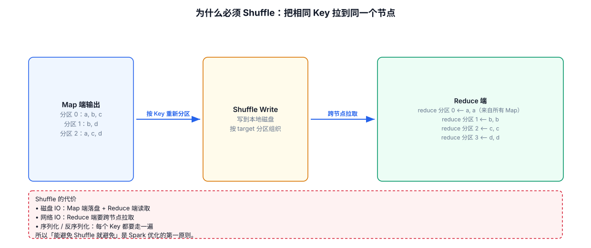
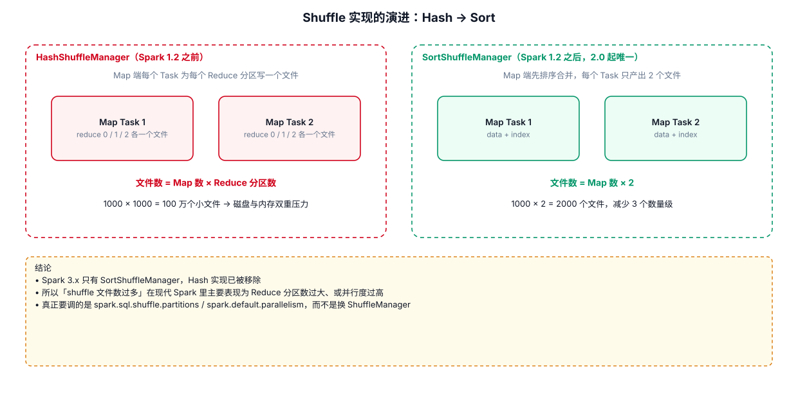
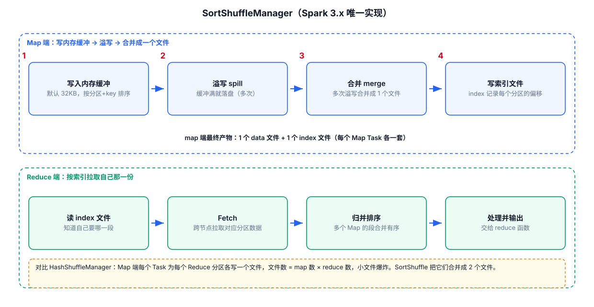
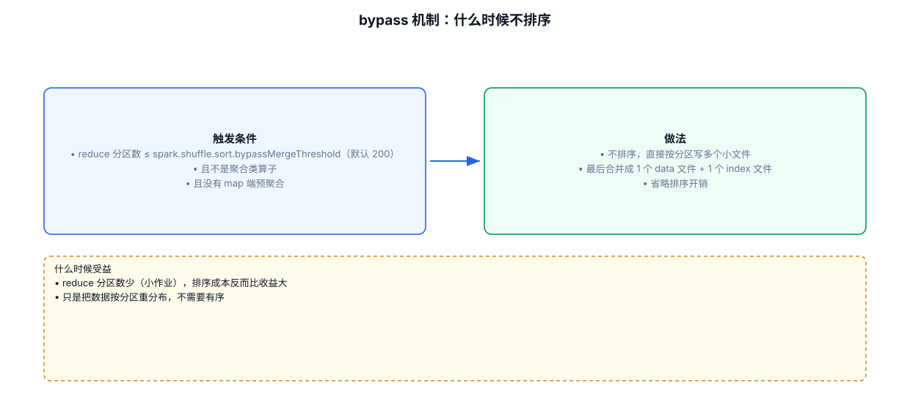

# 07 · Shuffle 专题

> 前面 03/04 章反复提到"是否 shuffle"，本章讲透 **shuffle 的判定标准与底层机制**。数据倾斜的定位与解决方案是独立主题，见 [08-数据倾斜专题](./08-数据倾斜专题.md)。

---



## 7.1 Shuffle 是什么

**Shuffle** = 数据在集群中**跨节点重新分配**的过程。当某个算子需要把**相同 key 的数据聚合到一起**时（如 groupByKey、reduceByKey、join），不同节点上的数据必须通过磁盘 + 网络传输到"属于该 key 的节点"，这个过程就是 shuffle。

```
    分区0：a, b, c         分区1：a, c         分区2：b, d
          │                    │                    │
          └──────────┬─────────┴─────────┬──────────┘
                     │    Shuffle（按 key 重新分发）  │
                     ▼                     ▼
              key=a 的所有数据        key=b 的所有数据
              聚到同一分区            聚到同一分区
```

> **一句话**：shuffle 就是把"分散在各节点的同 key 数据"搬到一起。搬数据 = 磁盘 IO + 序列化 + 网络传输，所以 shuffle 是分布式计算里**最昂贵**的操作。

### 常见的会产生 shuffle 的算子

| 类别 | 算子 / 语法 |
|---|---|
| 聚合类 | `groupByKey`、`reduceByKey`、`aggregateByKey`、`combineByKey` |
| 分组类 | `groupBy`、SQL 中的 `GROUP BY` |
| 关联类 | `join`、`cogroup`、SQL 中的 `JOIN` |
| 去重排序类 | `distinct`、`sortBy`、`sortByKey`、SQL 中的 `ORDER BY` |
| 重分区类 | `repartition`、`partitionBy`（`coalesce` 缩减不 shuffle） |

---

## 7.2 宽依赖 vs 窄依赖（shuffle 的判定标准）

| 依赖类型 | 定义 | 是否 shuffle | 典型算子 |
|---|---|---|---|
| **窄依赖** | 父 RDD 的每个分区最多被**一个**子分区使用 | **否** | map、flatMap、filter、mapValues |
| **宽依赖** | 父 RDD 的每个分区会被**多个**子分区使用 | **是** | groupByKey、reduceByKey、join、distinct、sortBy |

```
窄依赖（无 shuffle）：                    宽依赖（有 shuffle）：
  父分区 → 子分区（一对一/多对一）          父分区 → 多个子分区（一对多）
  P0 ─────▶ C0                          P0 ──┬──▶ C0
  P1 ─────▶ C0                          P1 ──┼──▶ C0
                                        P2 ──┴──▶ C1
```

> **记忆**：子分区如果只"认领"一个父分区，就是窄依赖（无 shuffle）；如果子分区需要从**多个父分区**拿数据，就是宽依赖（有 shuffle）。

### 为什么宽依赖要切 Stage

一个 Job 内部按 shuffle 边界切成多个 **Stage**：

```
Stage1（窄依赖）──shuffle──▶ Stage2（窄依赖）──shuffle──▶ Stage3
```

每个 Stage 内部是窄依赖，可以**流水线并行**；Stage 之间必须等上一阶段全部算完、数据 shuffle 到位，才能开始下一阶段。所以 **shuffle 次数越多，Stage 越多，性能越差**。

---

## 7.3 ShuffleManager 的演进与运行原理

Spark 历史上先后使用过两种 ShuffleManager，理解它们的差异，就理解了"shuffle 为什么慢、慢在哪"。

> **本项目 Spark 3.3.1 说明**：HashShuffleManager 从 Spark 2.0 起已被移除，3.x 只保留 SortShuffleManager。但理解 Hash → Sort 的演进过程，是理解 shuffle 文件数量问题的最佳路径。

### 7.3.1 未优化的 HashShuffleManager（历史机制）

每个 task 为**下游 stage 的每一个 task** 单独创建一个磁盘文件，相同 key 的数据写入同一个文件：



**文件数量公式**：`每个 task 创建的文件数 = 下一个 stage 的 task 数量`

举例：当前 stage 有 50 个 task（10 个 executor、每个 5 个 task），下游 stage 有 100 个 task → 每个 executor 创建 500 个文件，**全集群 5000 个**文件。海量小文件带来惊人的磁盘 IO 和句柄开销。

### 7.3.2 consolidate 优化后的 HashShuffleManager（历史机制）

开启 `spark.shuffle.consolidateFiles=true` 后，引入 **shuffleFileGroup** 复用机制：同一批并行执行的 task 复用同一组文件，下一批 task 继续往里追加：


**文件数量公式**：`每个 executor 的文件数 = CPU core 数 × 下游 task 数`

同上场景：每个 executor 100 个文件，全集群 **1000 个**（从 5000 → 1000）。但文件数量依然随并行度线性增长，治标不治本。

### 7.3.3 SortShuffleManager：普通运行机制（Spark 2.0+ 唯一机制）



运行过程四步：

1. 数据先写入**内存数据结构**：聚合类算子（reduceByKey 等）用 **Map**（边聚合边写），join 类普通算子用 **Array**。
2. 内存数据达到阈值后**溢写磁盘**，溢写前**按 key 排序**，分批写入（默认每批 1 万条，经 `BufferedOutputStream` 缓冲，减少磁盘 IO 次数）。
3. 多次溢写产生多个临时文件，最终 **merge 成一个磁盘文件**。
4. 额外生成一份**索引文件**，标识下游各 task 的数据在文件中的 offset 区间。

**文件数量公式**：`每个 task 只有 1 个数据文件 + 1 个索引文件`

同上场景：每个 executor 只有 **5 个**文件，全集群 **50 个**（5000 → 1000 → 50）。

### 7.3.4 SortShuffleManager：bypass 运行机制

**触发条件**（两个同时满足）：

1. shuffle map task 数量 **小于** `spark.shuffle.sort.bypassMergeThreshold`（默认 200）；
2. **不是聚合类** shuffle 算子（如 join、groupByKey 这类不需要 map 端聚合的算子）。



运行过程：为每个下游 task 创建一个临时文件按 hash 写入，最后合并成一个文件 + 索引文件。与普通机制的本质区别：**不进行排序**，省掉排序开销——磁盘写机制与老的 HashShuffleManager 一致，只是最后多一步合并。

### 7.3.5 文件数量演进总结

| 机制 | 文件总数（50 task × 10 executor × 100 下游 task） | 排序 |
|---|---|---|
| 未优化 Hash | 5000 | 否 |
| consolidate Hash | 1000 | 否 |
| Sort 普通 | 50 | 是 |
| Sort bypass | 50 | **否** |

---

## 7.4 Shuffle 调优参数

shuffle 调优参数解决的是"shuffle 已经不可避免时，让它少疼一点"：

| 参数 | 默认值 | 作用 | 调优建议 |
|---|---|---|---|
| `spark.shuffle.file.buffer` | 32k | shuffle write 的写盘缓冲大小 | 内存充足可调 64k，减少溢写次数，可提升 1%~5% |
| `spark.reducer.maxSizeInFlight` | 48m | shuffle read 每次拉取数据的缓冲大小 | 可调 96m，减少网络传输次数 |
| `spark.shuffle.io.maxRetries` | 3 | 拉取数据失败的重试次数 | 大作业（数十亿级）建议 60，避免 GC 停顿导致整个任务失败 |
| `spark.shuffle.io.retryWait` | 5s | 每次重试的等待间隔 | 配合上面调大（如 60s），提升稳定性 |
| `spark.shuffle.sort.bypassMergeThreshold` | 200 | map task 数低于该值且非聚合算子时启用 bypass（免排序） | 不需要排序时可调大，自动触发 bypass 机制 |
| `spark.sql.shuffle.partitions` | 200 | SQL/shuffle read 的分区数 | 数据量大时调大（1000~5000），配合 AQE 可让 AQE 自动向下合并 |
| `spark.shuffle.memoryFraction` | —（2.0 起废弃） | 旧版 shuffle 聚合内存占比 | 3.x 已改为统一内存管理，用 `spark.memory.fraction`（默认 0.6）替代 |
| `spark.shuffle.consolidateFiles` | —（2.0 起失效） | HashShuffleManager 的 consolidate 开关 | 3.x 只有 SortShuffleManager，此参数仅作历史了解 |

> **定位**：shuffle 参数调优在整个 Spark 性能优化中只占一小部分，大头永远是**代码写法（减少 shuffle）→ 资源配置 → 数据倾斜治理**（见 [08-数据倾斜专题](./08-数据倾斜专题.md)）。别舍本逐末。

---

## 7.5 本章小结

1. **Shuffle** = 同 key 数据跨节点重分配，代价 = 磁盘 IO + 序列化 + 网络。
2. **宽窄依赖**是判定标准：子分区依赖多个父分区 → 宽依赖 → 切 Stage 边界。
3. **ShuffleManager 演进**的核心是减少文件数量：Hash（5000 文件）→ consolidate（1000）→ Sort（50）；bypass 机制免排序。
4. **调优优先级**：减少 shuffle 次数（代码层）> 治理数据倾斜 > shuffle 参数微调。
