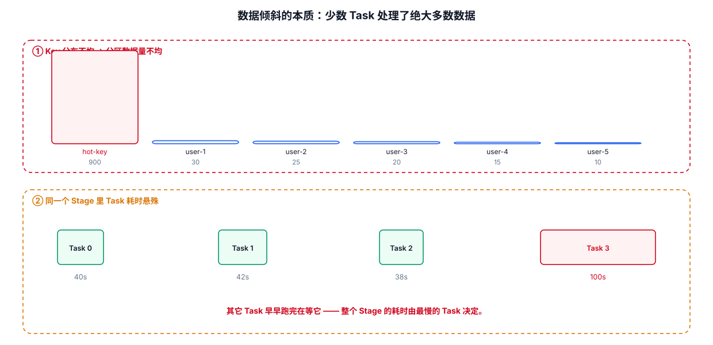
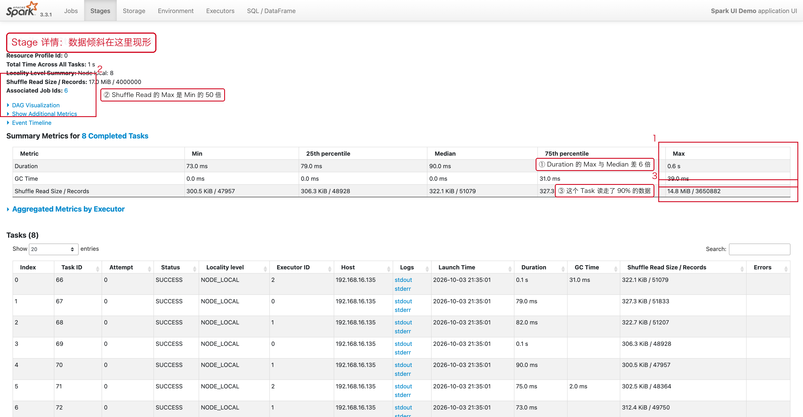
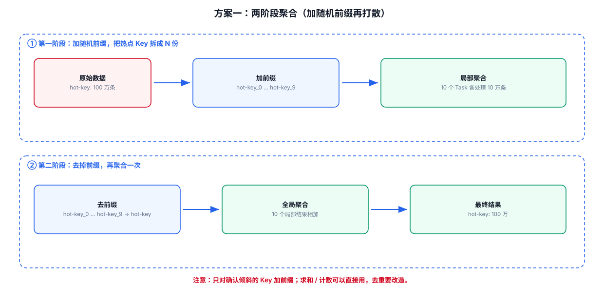
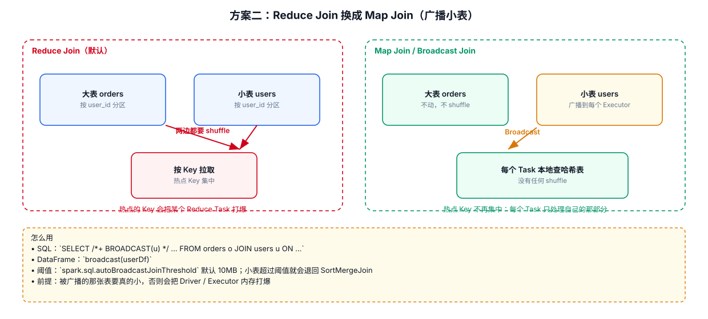
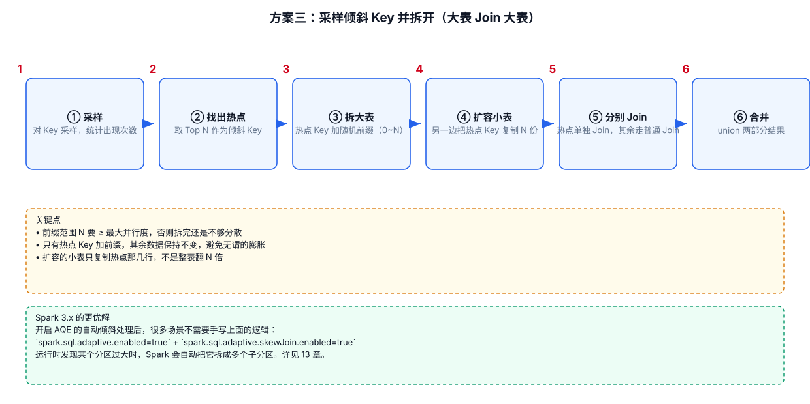

# 08 · 数据倾斜专题

> 数据倾斜是 shuffle 的"病"：[07-Shuffle专题](./07-Shuffle专题.md) 讲了机制，本章专讲**怎么发现、怎么治**——现象定位、八大通用方案、六大业务场景速查。

---

## 8.1 现象与原理

### 8.1.1 两种典型现象

1. **绝大多数 task 很快，个别 task 极慢**：比如 1000 个 task 里 997 个 1 分钟完成，剩下两三个跑了一两个小时——作业整体进度被少数 task 拖死。
2. **原本正常的作业突然 OOM**：某个 task 处理的数据量暴增导致内存溢出（注意：OOM 也可能是代码 bug 或脏数据，需用 8.2 的方法确认）。

### 8.1.2 发生原理

shuffle 时，相同的 key 必须被拉取到同一个 task 处理。如果某个 key 的数据量远超其他 key，这个 key 所在的 task 就会成为瓶颈——**整个作业的运行时间由最慢的那个 task 决定**（木桶效应）。



如上图：`hello` 这个 key 在三个节点上共有 7 条数据，全部拉到同一个 task；`world`、`you` 各只有 1 条。第一个 task 的运行时间可能是另外两个的 7 倍。真实业务里热点 key（爆款商品、超级大 V、null 值）动辄百万条，差距是指数级的。

---

## 8.2 定位三步法

**第一步：在 Web UI 找到倾斜的 Stage。** 打开 Spark Web UI（见 [15-SparkWebUI](./15-SparkWebUI.md)），进入 Stages 页，看每个 stage 内 task 的运行时间和数据量：



如果绝大多数 task 处理几百 KB、个别 task 处理几 MB 甚至几十 MB（差 10 倍以上），即可确认数据倾斜。

**第二步：根据 stage 划分原理倒推代码。** 代码中**每出现一个 shuffle 类算子（或 SQL 中的 group by / join），就是一条 stage 边界**（原理见 [07-Shuffle专题](./07-Shuffle专题.md) 7.2）。从倾斜的 stage 往前数 shuffle 边界，就能定位到是哪一行代码：

```java
// 例：wordCount 的 stage 划分
JavaRDD<String> lines = sc.textFile("hdfs://...");   // ┐
JavaRDD<String> words = lines.flatMap(...);           // ├─ stage 0（到 shuffle write 为止）
JavaPairRDD<String, Integer> pairs = words.mapToPair(...);
JavaPairRDD<String, Integer> counts = pairs.reduceByKey(Integer::sum);  // ← shuffle 边界
counts.collect();                                     // ┘ stage 1（shuffle read + 聚合）
```

**第三步（可选）：采样查看 key 的分布。** 对倾斜的 RDD 采样统计，确认到底是哪些 key 在捣乱：

```java
// 采样 10% 的数据，统计每个 key 的数量
JavaPairRDD<String, Integer> sampled = pairs.sample(false, 0.1);
Map<String, Long> keyCounts = sampled.countByKey();
keyCounts.forEach((k, v) -> System.out.println(k + " -> " + v));
```

---

## 8.3 八大通用解决方案

按"从简到繁"排列，**优先用前面的**：

### 方案一：源头预处理（Hive ETL）

**适用**：倾斜源自 Hive 表本身数据不均匀，且业务频繁对同一批表做分析。
**思路**：用 Hive ETL 提前按 key 聚合或提前 join 好中间表，Spark 直接读结果，不再执行 shuffle 算子。
**代价**：倾斜被"提前"到了 ETL 阶段，治标不治本，但换来 Spark 作业的大幅提速（交互式分析场景实测可提升数倍）。

### 方案二：过滤少数导致倾斜的 key

**适用**：倾斜 key 只有少数几个，且这些 key 对结果无意义（脏数据、测试账号、爬虫流量）。

```java
// RDD：直接 filter
rdd.filter(t -> t._1 != null && !t._1.isEmpty());
// DataFrame / SQL：where 过滤
df.filter(col("key").isNotNull());
spark.sql("SELECT ... FROM t WHERE key IS NOT NULL AND key != ''");
```

> 若不确定哪些 key 倾斜，可动态采样后过滤数据量最大的 key（见 8.2 第三步）。

### 方案三：提高 shuffle 并行度

**适用**：直面倾斜时**优先尝试**的最简单手段。

> 提高 shuffle 并行度的效果可以用 [spark-narrow-wide.svg](./images/spark-narrow-wide.svg) 来理解：
> 分区数变多以后，原本挤在一个分区里的数据会被摊到更多分区上，单个 Task 的数据量随之下降。

```java
// RDD 层面：给 shuffle 算子传分区参数
rdd.reduceByKey((x, y) -> x + y, 1000);
// SQL 层面：调大 shuffle 分区数（默认 200，很多场景偏小）
spark.conf().set("spark.sql.shuffle.partitions", "2000");
```

**原理**：增加 shuffle read task 数量，让原本挤在一个 task 的多个 key 分散开。
**局限**：只是缓解不是根治——**同一个 key 的数据永远会落在同一个 task**，极端倾斜（单 key 百万条）时调多少分区都没用。

### 方案四：两阶段聚合（加盐打散，聚合类首选）

**适用**：`reduceByKey`、`aggregateByKey` 等**聚合类**算子或 SQL `GROUP BY` 产生的倾斜。



四步走：**加盐 → 局部聚合 → 去盐 → 全局聚合**：

```java
// ① 每个 key 打上 0~9 的随机前缀
JavaPairRDD<String, Integer> prefixed = rdd.mapToPair(t ->
        new Tuple2<>(new Random().nextInt(10) + "_" + t._1, t._2));

// ② 局部聚合：hot_key 被打散成 0_hot_key ~ 9_hot_key，分散到 10 个 task
JavaPairRDD<String, Integer> localAggr = prefixed.reduceByKey(Integer::sum);

// ③ 去掉前缀
JavaPairRDD<String, Integer> removed = localAggr.mapToPair(t ->
        new Tuple2<>(t._1.split("_", 2)[1], t._2));

// ④ 全局聚合：此时每个 key 的数据量已缩小为原来的 1/10
JavaPairRDD<String, Integer> result = removed.reduceByKey(Integer::sum);
```

> **原理**：`(hello,1)×4` → 加盐后 `(1_hello,1)(1_hello,1)(2_hello,1)(2_hello,1)` → 局部聚合 `(1_hello,2)(2_hello,2)` → 去盐 `(hello,2)(hello,2)` → 全局聚合 `(hello,4)`。对聚合类倾斜通常有数倍提升；**局限**：只适用于聚合类，join 类要用方案五/六/七。

### 方案五：reduce join 转 map join（小表广播）

**适用**：join 两边**一大一小**（小表几百 MB 到一两 GB）。



普通 join（reduce join）两边都要 shuffle；广播小表后，join 在 map 端本地完成，**完全不发生 shuffle**：

```java
// DataFrame 写法（最常用）
import static org.apache.spark.sql.functions.broadcast;
df1.join(broadcast(df2), "key");   // 小表 df2 广播到每个 executor

// RDD 写法：collect 小表 → broadcast → map 端比对
List<Tuple2<Long, Row>> small = smallRdd.collect();           // 拉到 Driver
Broadcast<List<Tuple2<Long, Row>>> bc = sc.broadcast(small);  // 广播
JavaPairRDD<Long, String> joined = bigRdd.mapToPair(t -> {
    // 在算子内从广播变量取小表数据比对（小表 key 唯一时适用）
    ...
});
```

**注意**：小表会常驻 Driver 和每个 Executor 的内存，广播超过 10GB 的表可能 OOM。SQL 下可用 `spark.sql.autoBroadcastJoinThreshold`（默认 10MB）控制自动广播阈值，超小表 Spark 会自动广播。

### 方案六：采样倾斜 key 并分拆 join

**适用**：两个**大表** join（无法广播），但倾斜 key 只有少数几个。



思路：把倾斜 key 拆出来单独处理，正常 key 正常 join：

```java
// ① 采样找出倾斜 key（如数据量最大的 userid）
JavaPairRDD<String, Integer> sampled = rdd1.sample(false, 0.1);
String skewedKey = /* 统计后取 top1 */;

// ② 表1 拆分：倾斜 key 数据（打 0~99 随机前缀） + 正常 key 数据
// ③ 表2 拆分：倾斜 key 数据膨胀 100 倍（每条复制 100 份，打上 0~99 前缀） + 正常 key 数据
// ④ 倾斜部分 join：打散后的 key 分散到 100 个 task
// ⑤ 正常部分照常 join
// ⑥ 两次结果 union
```

> **与方案七的区别**：只对**少数倾斜 key** 扩容，内存开销小；倾斜 key 成千上万个时不适用。

### 方案七：随机前缀 + 整体扩容 join（最后手段）

**适用**：**大量** key 都倾斜的大表 join，方案六拆不动时的兜底。

```java
int n = 100;
// 表1：每条数据打上 0~n 的随机前缀
// 表2：整体膨胀 n 倍，每条数据复制 n 份、分别打上 0~n 前缀
// join 后去掉前缀恢复原 key
```

**代价**：对整个 RDD 扩容 n 倍，内存要求高，且更多是缓解而非根治。实测一个严重倾斜的 join 从 60 分钟优化到 10 分钟左右。

### 方案八：组合使用

复杂场景没有银弹：典型组合是"**方案一/二 先过滤预处理 → 方案三 提并行度兜底 → 聚合类用方案四 → join 类按表大小选方案五/六/七**"。

---

## 8.4 按业务场景对症下药

通用方案讲完，实战中更常见的是**按"哪类操作产生的倾斜"来选方案**。以下按场景整理速查手册：

### 8.4.1 join 产生的倾斜

| 手段 | 适用条件 | 要点 |
|---|---|---|
| **过滤异常值** | 空值、默认值 key 无业务意义 | join 前先 `WHERE key IS NOT NULL AND key != ''`，或把异常值**单独拆出来**走独立逻辑（比如统一写回一张异常表），不要混在主流程里陪跑 |
| **小表广播** | 一边是小表（<1~2GB） | `broadcast(df)` 或调 `spark.sql.autoBroadcastJoinThreshold`，map 端本地 join，零 shuffle |
| **加盐打散** | 两边都是大表 | 倾斜 key 加随机前缀 + 另一边膨胀对应倍数（即方案六/七） |
| **分桶表** | 两表都按 join key 分桶 | 预分桶使相同 key 的数据物理上就落在同一批文件，join 时直接 Bucket Join **跳过 shuffle**；要求两表桶数成倍数、分桶列 = join 列（分桶建表见 [12-SparkSQL数据工程与Hive](./12-SparkSQL数据工程与Hive.md)） |

```sql
-- 分桶表示例：建表时就按 user_id 分 64 个桶
CREATE TABLE user_action (user_id BIGINT, act STRING)
CLUSTERED BY (user_id) INTO 64 BUCKETS
STORED AS ORC;

-- 与同样按 user_id 分 64（或 128/32 等倍数）桶的 user_dim join 时，
-- Spark 可自动识别并触发 bucket join，免 shuffle
```

### 8.4.2 group by 产生的倾斜

| 手段 | 要点 |
|---|---|
| **双阶段聚合** | 即方案四：加盐局部聚合 → 去盐全局聚合。SQL 等价写法是 `GROUP BY concat(floor(rand()*10), '_', key)` 再二次聚合 |
| **map 端预聚合** | 用带 combiner 的算子（`reduceByKey` / `aggregateByKey`）代替 `groupByKey`；Spark SQL 会自动做 map 端部分聚合，确认没被关闭 |
| **先过滤再聚合** | 聚合前先把不参与统计的行过滤掉（时间范围、状态值、空值），数据量减半，倾斜自然缓解——**最容易被忽略、性价比最高**的一招 |

> **map 端预聚合原理**：每个分区先把相同 key 局部聚合，shuffle 只传 `(key, 局部结果)`；不预聚合则 shuffle 传 `(key, 全部原始记录)`。数据量相差可达数量级。

### 8.4.3 count(distinct) 产生的倾斜

`count(DISTINCT key)` 会把**所有不同 key 的值拉到同一个 task** 做全局去重，key 一多必倾斜。三种替代：

**① 改写为 group by + count（精确，最常用）**：

```sql
-- 改写前：全部数据挤进一个 task 去重
SELECT count(DISTINCT user_id) FROM t;

-- 改写后：先分组（分组会分散到多个 task），再数行数，两阶段完成
SELECT count(*) FROM (
    SELECT user_id FROM t WHERE user_id IS NOT NULL GROUP BY user_id
) x;
```

**② HyperLogLog 近似去重（允许 1%~2% 误差时，性能最好）**：

```sql
-- 数据量极大、只要量级不要精确值时使用
SELECT approx_count_distinct(user_id) FROM t;
```

**③ 位图 Bitmap（distinct 值域有限时，精确且快）**：

```sql
-- 如 user_id 是 0~1000 万的整数 ID，可用 bitmap 精确去重
-- 每个值只占 1 bit，1 亿 ID 约 12MB，聚合开销极小
```

| 方案 | 精确性 | 性能 | 适用 |
|---|---|---|---|
| group by + count(*) | 精确 | 好 | 默认选择 |
| approx_count_distinct | ~1-2% 误差 | 极好 | 超大数据、看趋势 |
| Bitmap | 精确 | 极好 | distinct 值为有限整数集 |

### 8.4.4 空值、默认值导致的倾斜

脏 key（`null`、`''`、`0`、`-1`、`'unknown'`）是实践中最高频的倾斜元凶，因为所有"没有值"的记录都会聚到同一个 key 上：

```sql
-- 手段一：直接过滤（无业务意义时）
SELECT ... FROM t WHERE key IS NOT NULL AND key NOT IN ('', 'unknown', '-1');

-- 手段二：用随机数代替 null（空值有业务意义、不能丢时）
-- 把 null key 替换为随机数，让它们打散到不同 task，聚合后再单独归类
SELECT ... FROM (
    SELECT coalesce(key, concat('null_', floor(rand() * 100))) AS key, ...
    FROM t
) x;
```

> **选择原则**：空值对统计无意义 → 过滤；空值需要保留在结果里 → 随机数打散（或单独拆出来处理再 union 回去）。

### 8.4.5 动态分区写入倾斜

往 Hive 分区表写数据时，若数据集中在少数分区（如"日期+城市"里北上广深占大头），写这几个分区的 task 会远慢于其他，且**动态分区会在写入时缓存大量文件句柄**引发 OOM。

| 手段 | 做法 |
|---|---|
| **预创建分区** | 写入前把目标分区 `ALTER TABLE ... ADD PARTITION` 建好，减少动态推断分区的内存与句柄开销 |
| **关闭动态分区** | 业务允许时改为**静态分区**写入（`INSERT OVERWRITE TABLE t PARTITION(dt='2026-09-30')`），一次只写一个分区，最干净 |
| **开启倾斜优化** | Spark 3.x 的 AQE 自动倾斜处理（见下），对写入阶段的倾斜 task 自动拆分 |
| 分区裁剪 | 读取端配合 `WHERE dt=...` 谓词下推，别全表扫描再分区 |

```sql
-- 动态分区写入的典型配置（Spark 写 Hive）
SET spark.sql.sources.partitionOverwriteMode=dynamic;  -- 动态分区覆盖
SET spark.hadoop.hive.exec.dynamic.partition.mode=nonstrict;  -- 允许全部动态分区
```

### 8.4.6 小文件问题与 AQE 自动优化

**小文件倾斜**是另一面的问题：分区过多过细 → 每个 task 只处理几百 KB → task 调度开销反而大于计算本身，NameNode 也被小文件拖垮。

**手段一：写入前合并小文件**。`repartition(n)` 控制输出文件数（n = 总数据量 / 每文件期望大小）：

```java
// 期望每文件 128MB，总数据 1GB → repartition(8)
df.repartition(8).write().parquet("output");
```

**手段二：AQE 自动合并小分区**。Spark 3.0+ 的自适应查询执行（Adaptive Query Execution，3.2 起默认开启）会在运行时根据**实际**统计信息自动做三件事：**合并小分区、拆分倾斜分区、切换 join 策略**：

```properties
# AQE 总开关（Spark 3.2+ 默认 true）
spark.sql.adaptive.enabled=true
# 自动合并过小的 shuffle 分区
spark.sql.adaptive.coalescePartitions.enabled=true
# 自动拆分倾斜分区（倾斜 join 的自动解药）
spark.sql.adaptive.skewJoin.enabled=true
# 判定倾斜的因子：分区数据量超过中位数 × 该因子即视为倾斜（默认 5）
spark.sql.adaptive.skewJoin.skewedPartitionFactor=5
# 倾斜分区的绝对阈值（默认 256MB）
spark.sql.adaptive.skewJoin.skewedPartitionThresholdInBytes=256MB
```

> **AQE 与手动方案的关系**：AQE 解决了大部分"通用倾斜"，让方案三/四/七的使用频率大幅下降；但 AQE 只作用于 shuffle read 阶段的自动拆分，**源头脏数据（空值）和大表间业务性热点 key 仍需手动方案**。生产实践 = AQE 打底 + 手动方案针对顽固倾斜。

---

## 8.5 高频面试题与调优口诀

### 面试题一：groupByKey vs reduceByKey 为什么性能差这么多？

**reduceByKey 有 map 端预聚合（combiner）**：每个分区先局部聚合，shuffle 只传 `(key, 局部和)`；**groupByKey 不预聚合**，shuffle 传全量原始记录。数据量一大，网络与磁盘开销相差数量级。

```
reduceByKey：分区内先 sum → shuffle 传 (key, 局部和) → 再 sum   [数据量小]
groupByKey ：分区内不聚合 → shuffle 传 (key, 全部 value) → 再 sum [数据量大]
```

### 面试题二：如何排查一场数据倾斜？

**看现象**（少数 task 极慢 / OOM）→ **Web UI 定位 stage**（task 数据量差 10 倍以上）→ **倒推代码**（数 shuffle 边界）→ **采样 key 分布**（sample + countByKey）→ **按场景选方案**（见 8.4）。

### 面试题三：Spark 3.x 的 AQE 如何改变数据倾斜治理？

运行时基于真实统计优化执行计划：合并小分区（治小文件）、拆分倾斜分区（治倾斜 join）、大表 join 自动转广播（治 join 策略失误）。把过去很多手动调优变成了默认行为，但源头脏数据与业务热点仍需手动治理。

### 调优口诀

1. **能不用 shuffle 就不用**：`map`/`filter`/`mapValues` 优于 `groupByKey`。
2. **能预聚合就预聚合**：`reduceByKey` / `aggregateByKey`，聚合前先过滤。
3. **小表 join 用广播**：彻底消除 shuffle；两表都大考虑分桶。
4. **脏 key 先清洗**：空值、默认值过滤或打散，是性价比最高的手段。
5. **聚合倾斜用加盐**：两阶段聚合是聚合类倾斜的标准解。
6. **去重别硬扛**：count distinct 改 group by + count，或上 HyperLogLog。
7. **AQE 打底**：3.x 先开 AQE，再对顽固倾斜手动治理。
8. **观察 Spark UI**：一切调优从"看见倾斜"开始（见 [15-SparkWebUI](./15-SparkWebUI.md)）。

---

## 8.6 本章小结

1. **数据倾斜**只发生在 shuffle：同 key 必落同一 task，热点 key 拖垮全局；定位靠 Web UI 找 stage + 倒推代码 + 采样 key。
2. **八大通用方案**：源头预处理 → 过滤 key → 提并行度 → 两阶段聚合 → 小表广播 → 分拆 join → 扩容 join → 组合拳。
3. **场景速查**：join 倾斜（过滤异常值/广播/加盐/分桶）、group by 倾斜（双阶段/map 端预聚合/先过滤）、count distinct（group by 改写/HLL/位图）、空值倾斜（过滤/随机数）、动态分区（预建/静态写入）、小文件（repartition/AQE 合并）。
4. **Spark 3.x 心法**：AQE 自动兜底 + 手动方案治顽固倾斜。
