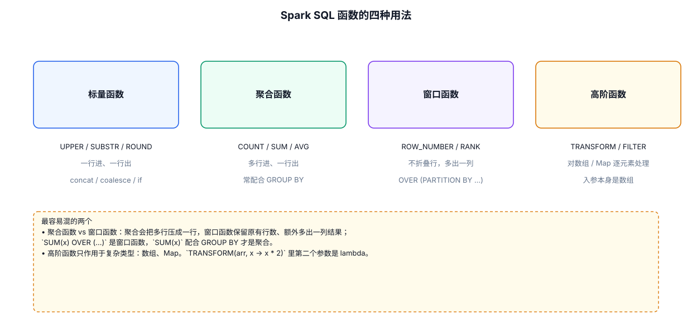

# 10 · SQL 语法与内置函数

---



## 10.1 准备数据：把项目数据注册成视图

后续所有示例共用这段初始化代码（把 `user_visit_action` 点击流和 `city_info` 城市表注册成视图）：

```java
package org.SparkSQL;

import org.apache.spark.sql.Dataset;
import org.apache.spark.sql.Row;
import org.apache.spark.sql.SparkSession;

public class SQLDemo
{
    public static void main(String[] args) {
        SparkSession spark = SparkSession
                .builder()
                .appName("SQLDemo")
                .config("spark.driver.host", "localhost")
                .master("local[*]")
                .getOrCreate();

        // 点击流：制表符分隔、无表头，手动指定列名
        Dataset<Row> action = spark.read()
                .option("sep", "\t").option("header", "false")
                .csv("Spark/src/main/data/user_visit_action")
                .toDF("dt", "user_id", "session_id", "page_id", "action_time",
                        "search_keyword", "click_category_id", "click_product_id",
                        "order_category_ids", "order_product_ids",
                        "pay_category_ids", "pay_product_ids", "city_id");
        action.createOrReplaceTempView("action");

        // 城市表：city_id / city_name / area
        Dataset<Row> city = spark.read()
                .option("sep", "\t").option("header", "false")
                .csv("Spark/src/main/data/city_info")
                .toDF("city_id", "city_name", "area");
        city.createOrReplaceTempView("city");

        // 用户表：JSON 自带列名
        spark.read().json("Spark/src/main/data/user.json").createOrReplaceTempView("user");

        // ---- 后续示例的 spark.sql("...") 都写在这里 ----

        spark.stop();
    }
}
```

> **知识点**：`csv()` 读取器 + `sep` 选项可以读任意分隔符的文本；无表头时用 `toDF(...)` 手动命名。读进来的列默认都是 **String 类型**，数值计算前要 `cast`。

## 10.2 SELECT 查询全貌

一条 SQL 的执行顺序（面试常考）：`FROM → WHERE → GROUP BY → HAVING → SELECT → ORDER BY → LIMIT`。写的时候是 SELECT 在前，**执行的时候 FROM 在前**。

```sql
-- 基础查询 + 别名 + 去重
SELECT DISTINCT user_id AS uid FROM action;

-- WHERE 过滤：cast 把字符串转成数值再比较
SELECT user_id, click_product_id
FROM action
WHERE click_product_id != '-1' AND cast(page_id AS int) > 10;

-- 分组聚合 + HAVING（过滤分组后的结果，WHERE 过滤不了聚合值）
SELECT user_id, count(*) AS click_cnt
FROM action
WHERE click_product_id != '-1'          -- 先过滤行
GROUP BY user_id
HAVING count(*) > 100                   -- 再过滤组
ORDER BY click_cnt DESC
LIMIT 5;

-- CAST 类型转换的两种写法
SELECT cast(age AS int) + 1 FROM user;      -- 标准写法
SELECT age + 1 FROM user;                   -- 隐式转换（能转就自动转）
```

> **WHERE vs HAVING**：WHERE 在分组前过滤**行**，HAVING 在分组后过滤**组**。对普通条件永远用 WHERE——先过滤能大幅减少参与 shuffle 的数据量（见 [08-数据倾斜专题](./08-数据倾斜专题.md) 8.4.2"先过滤再聚合"）。

## 10.3 多表 JOIN：7 种类型

以 `action`（点击流）join `city`（城市表）为例，on 条件 `action.city_id = city.city_id`：

| JOIN 类型 | 语义 | 保留哪边 |
|---|---|---|
| `INNER JOIN` | 只保留两表都能匹配上的行 | 都不保留 |
| `LEFT [OUTER] JOIN` | 左表全保留，右表匹配不上的填 null | 左表 |
| `RIGHT [OUTER] JOIN` | 右表全保留，左表匹配不上的填 null | 右表 |
| `FULL [OUTER] JOIN` | 两表都全保留，匹配不上的互相填 null | 两边 |
| `LEFT SEMI JOIN` | 只返回左表中**能匹配上**的行（不带右表列） | 左表（筛选用） |
| `LEFT ANTI JOIN` | 只返回左表中**匹配不上**的行 | 左表（反向筛选用） |
| `CROSS JOIN` | 笛卡尔积，m × n 行 | — |

```java
// INNER JOIN：统计每个城市的点击量（SQL 与 DataFrame 双写对照）

// 写法一：SQL
spark.sql(
    "SELECT c.city_name, count(*) AS click_cnt " +
    "FROM action a JOIN city c ON a.city_id = c.city_id " +
    "WHERE a.click_product_id != '-1' " +
    "GROUP BY c.city_name ORDER BY click_cnt DESC"
).show();

// 写法二：DataFrame DSL
action.join(city, action.col("city_id").equalTo(city.col("city_id")))
        .filter(action.col("click_product_id").notEqual("-1"))
        .groupBy(city.col("city_name"))
        .count()
        .orderBy(org.apache.spark.sql.functions.desc("count"))
        .show();
```

```sql
-- LEFT SEMI / ANTI：半连接与反连接（做"存在性筛选"时比 inner join 快）
-- 哪些城市有点击记录（只要城市名，不要点击明细）
SELECT * FROM city LEFT SEMI JOIN action ON city.city_id = action.city_id;

-- 哪些城市没有任何点击记录
SELECT * FROM city LEFT ANTI JOIN action ON city.city_id = action.city_id;
```

> **知识点**：
> - join 列同名时可以简写 `JOIN city USING (city_id)`。
> - 大表 join 小表优先**广播**（见 [08-数据倾斜专题](./08-数据倾斜专题.md) 方案五），city 这种几十行的小表会自动广播。
> - DataFrame 的 join 列名相同时直接写 `action.join(city, "city_id")`，避免两列重名。

## 10.4 子查询

```sql
-- 标量子查询：子查询结果当"一个值"用
SELECT *
FROM action
WHERE cast(user_id AS int) = (SELECT max(cast(user_id AS int)) FROM action);

-- IN 子查询：等价于 LEFT SEMI JOIN
SELECT * FROM action
WHERE city_id IN (SELECT city_id FROM city WHERE area = '华北');

-- FROM 子查询（派生表）：先聚合再join，是"多步统计"的标准写法
SELECT c.city_name, t.click_cnt
FROM (
    SELECT city_id, count(*) AS click_cnt
    FROM action WHERE click_product_id != '-1'
    GROUP BY city_id
) t
JOIN city c ON t.city_id = c.city_id;
```

> **知识点**：子查询在 Spark 里会被 Catalyst（见 [13-SparkSQL原理与性能](./13-SparkSQL原理与性能.md)）自动改写成 join，不必担心性能；`IN 子查询`通常被优化成 semi join。

## 10.5 临时视图 vs 全局临时视图

| 对比项 | 临时视图 | 全局临时视图 |
|---|---|---|
| 注册方法 | `createOrReplaceTempView` | `createOrReplaceGlobalTempView` |
| 作用域 | 当前 SparkSession | **所有** SparkSession（同一应用内） |
| 访问方式 | `select * from user` | `select * from global_temp.user` |
| 生命周期 | session 停止即销毁 | 应用停止即销毁 |

```java
// 会话级临时视图：只在当前 spark 会话可见
df.createOrReplaceTempView("user");

// 全局临时视图：新开一个 session 也能查
df.createOrReplaceGlobalTempView("g_user");

// 访问全局临时视图必须加 global_temp. 前缀
spark.newSession().sql("SELECT * FROM global_temp.g_user").show();
```

> **知识点**：全局临时视图存在系统数据库 `global_temp` 里，所以访问要带前缀；两个 session 各自 `createOrReplaceTempView("x")` 互不干扰，但全局视图同名会冲突。

## 10.6 内置函数速查

实际工作中内置函数的使用频率远高于 UDF——先翻这里，不够再自己写。

| 类别 | 常用函数 | 示例 |
|---|---|---|
| 字符串 | `concat` / `concat_ws` | `concat_ws('-', city_name, area)` |
| | `substring(s, pos, len)` | `substring(action_time, 1, 10)` 取日期部分 |
| | `split(s, p)` / `explode` | `explode(split(order_product_ids, ','))` |
| | `upper` / `lower` / `trim` / `length` | `upper(city_name)` |
| | `regexp_replace(s, p, r)` | `regexp_replace(dt, '-', '')` → 20190717 |
| 日期 | `current_date` / `current_timestamp` | `SELECT current_date()` |
| | `date_format(d, fmt)` | `date_format(action_time, 'yyyy-MM')` |
| | `datediff(a, b)` / `date_add` / `date_sub` | `datediff('2019-07-20', dt)` |
| | `to_date` / `to_timestamp` | `to_date(substring(action_time,1,10))` |
| 数学 | `abs` / `round` / `ceil` / `floor` / `pow` | `round(avg_age, 2)` |
| 聚合 | `count` / `sum` / `avg` / `min` / `max` | `count(DISTINCT user_id)` |
| | `collect_list` / `collect_set` | `collect_set(city_id)` 聚合成数组 |
| 条件 | `if(cond, a, b)` | `if(click_product_id == '-1', '浏览', '点击')` |
| | `CASE WHEN ... THEN ... ELSE ... END` | 见下 |
| | `coalesce(a, b, c)` | 依序取第一个非 null 值 |
| 空值 | `isnull` / `isnotnull` / `nvl(a, b)` | `nvl(search_keyword, '无')` |
| 数组/Map | `size` / `array_contains` / `explode` | `size(split(order_product_ids, ','))` |

```sql
-- CASE WHEN 分段统计 + collect_set 聚合数组，综合示例
SELECT c.city_name,
       count(*) AS click_cnt,
       sum(CASE WHEN a.search_keyword != '\\N' THEN 1 ELSE 0 END) AS search_cnt,
       collect_set(c.area) AS areas
FROM action a JOIN city c ON a.city_id = c.city_id
GROUP BY c.city_name;
```

> **注意**：本项目数据里空值是字符串 `\N`（不是 SQL 的 NULL），判断时用 `!= '\\N'`；真实 Hive 表读进来通常已是 null，用 `isnotnull(col)`。

## 10.7 本章小结

1. **执行顺序** FROM → WHERE → GROUP BY → HAVING → SELECT → ORDER BY → LIMIT；过滤尽早做。
2. **7 种 JOIN**：inner/left/right/full 保数据，semi/anti 做存在性筛选，cross 笛卡尔积慎用。
3. **子查询**会被 Catalyst 自动改写优化，放心写；多步统计用 FROM 派生表。
4. **全局临时视图**跨 session 共享，访问加 `global_temp.` 前缀。
5. **内置函数优先**，写 UDF 前先查速查表。
