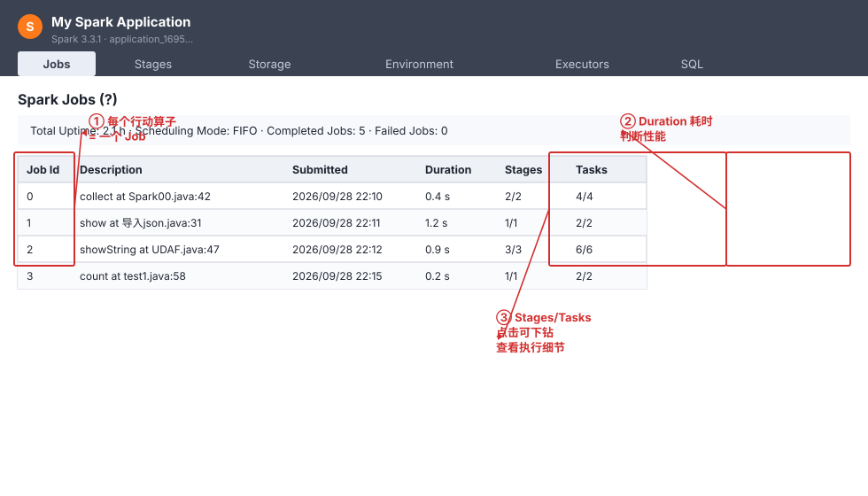
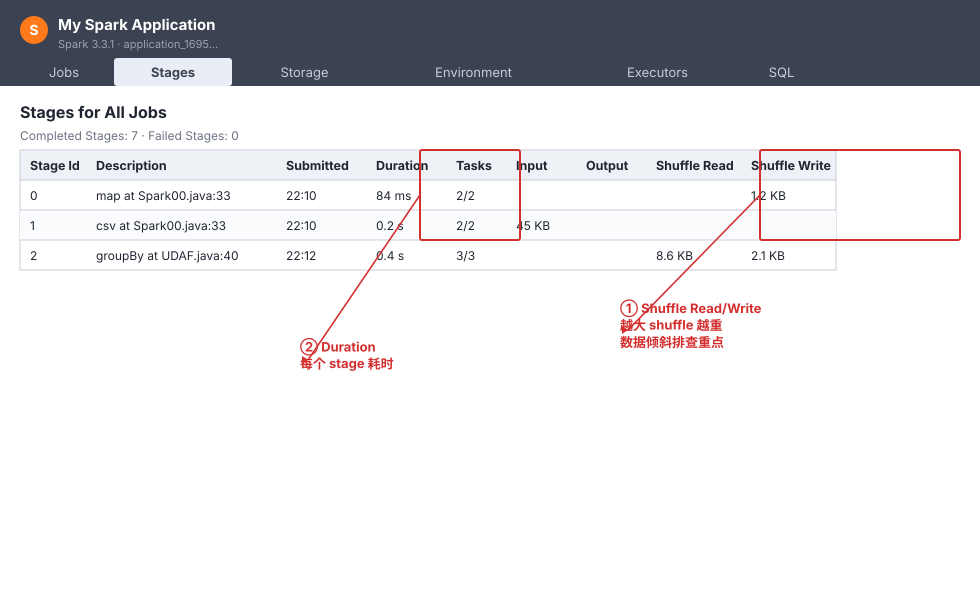
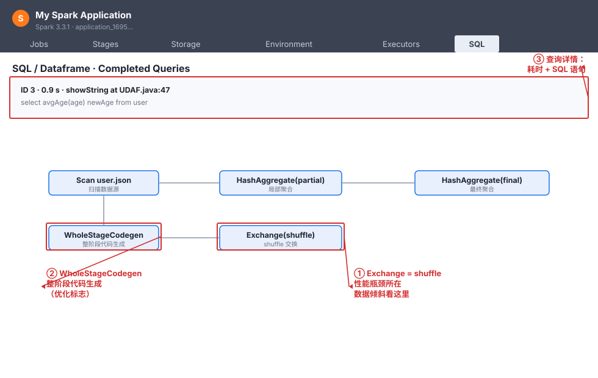
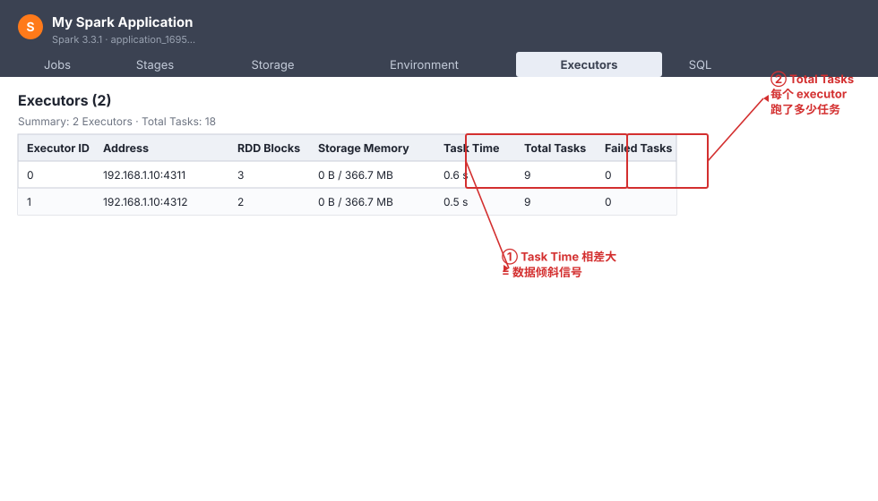
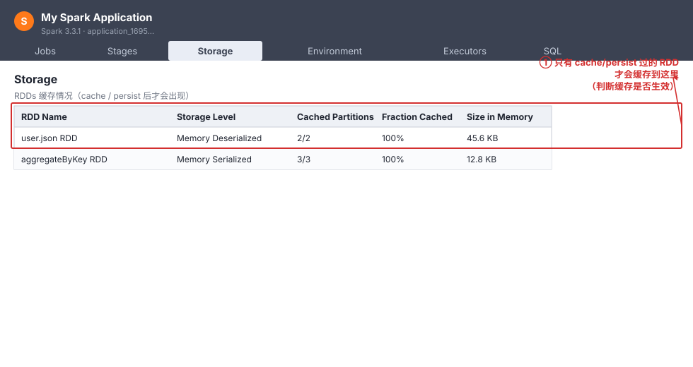
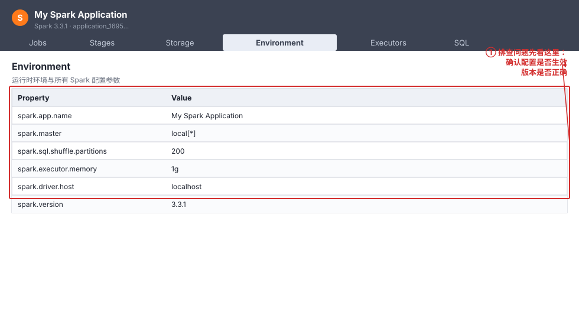

# 10 · Spark Web UI 运维界面详解

> 提交作业后（见 01 章 1.4 作业提交），如何监控运行情况、排查性能问题？答案就是 **Spark Web UI**——一个随应用启动的内置 Web 监控界面。
>
> **入口**：本地/`client` 模式默认 `http://localhost:4040`；`cluster` 模式通过 YARN 的 ApplicationMaster 跳转。作业运行期间实时更新，作业结束后仍可查看历史。

## 10.1 认识 Web UI：导航栏与整体布局

打开 Web UI，顶部是一条**深色导航栏**，固定包含 6 个标签页，对应 6 大功能模块：

| 标签页 | 作用 | 什么时候看 |
|---|---|---|
| **Jobs** | 所有 Job（作业）列表 | 总览运行了几个 Job、耗时 |
| **Stages** | 所有 Stage（阶段）列表 | 定位 shuffle、看数据量 |
| **Storage** | RDD 缓存情况 | 检查 `cache`/`persist` 是否生效 |
| **Environment** | 运行时环境与配置 | 排查配置/版本问题 |
| **Executors** | 每个 Executor 的资源和任务 | 查数据倾斜、内存 |
| **SQL** | SparkSQL 查询的 DAG | 看 SQL 执行计划 |

> 核心记忆：**每个行动算子 = 一个 Job**（同 04 章 4.0 节），Web UI 的 Jobs 页面就是把你程序里触发的所有行动算子列出来。

---

## 10.2 Jobs 页面：作业总览

Jobs 页面列出应用运行的所有 Job，是排查问题的**第一站**。

**怎么看：**

| 关注点 | 说明 |
|---|---|
| ① Job 数量 | 每个行动算子对应一个 Job，Job 数 = 你程序里触发的行动算子数 |
| ② Duration | 每个 Job 的耗时，耗时异常的 Job 就是性能瓶颈点 |
| ③ Stages/Tasks | 点进去下钻到该 Job 的 Stages 详情 |

> **排查心法**：哪个 Job 耗时最长 → 点进去看它的 Stages → 再定位到具体 Stage 的 shuffle。

---

## 10.3 Stages 页面：定位 shuffle 与数据量

Stages 页面展示所有 Stage，最关键的列是 **Shuffle Read / Shuffle Write**。

**怎么看：**

| 关注点 | 说明 |
|---|---|
| ① Shuffle Read/Write | **越大说明 shuffle 越重**，是数据倾斜、性能瓶颈的排查重点 |
| ② Duration | 每个 Stage 的耗时，耗时最长的 Stage 就是优化目标 |

> **进阶**：点击某个 Stage 进入详情页，能看到该 Stage 内部每个 Task 的执行时间分布——如果少数 Task 时间远长于其他，就是**数据倾斜**（详见 07 章）。

---

## 10.4 SQL 页面：SparkSQL 执行计划（DAG）

这是 SparkSQL 开发者最常用的页面。它把一条 SQL 的**执行计划画成 DAG 图**，每个节点是一个算子。

**怎么看：**

| 关注点 | 说明 |
|---|---|
| ① Exchange | 就是 **shuffle** 节点，出现一个 Exchange 就多一次 shuffle，是性能瓶颈 |
| ② WholeStageCodegen | 整阶段代码生成，**优化的标志**，出现越多越好 |
| ③ 查询详情 | 顶部显示耗时和 SQL 语句 |

> **关键心法**：DAG 里的 **Exchange 节点越少，SQL 越快**。看到多个 Exchange，就想办法减少 shuffle（如广播 join、减少 groupBy 次数）。扫描节点（Scan）对应读数据源。

---

## 10.5 Executors 页面：查数据倾斜

Executors 页面列出所有 Executor 的资源占用和任务执行情况。

**怎么看：**

| 关注点 | 说明 |
|---|---|
| ① Task Time | **各 Executor 的 Task Time 相差大 = 数据倾斜的信号** |
| ② Total Tasks | 每个 Executor 跑了多少任务，判断负载是否均衡 |
| Storage Memory | 每个 Executor 用了多少缓存内存 |

> **排查心法**：如果看到某个 Executor 的 Task Time 远大于其他，说明数据倾斜，参考 07 章方案解决。

---

## 10.6 Storage 页面：缓存是否生效

Storage 页面显示被 `cache`/`persist` 缓存起来的 RDD。

**怎么看：**

- **只有 cache/persist 过的 RDD 才会出现在这里**。
- 如果发现某个 RDD 没有出现在列表，说明它的缓存没生效（可能漏写 `cache()` 或缓存被淘汰）。
- 关注 `Fraction Cached`（缓存比例）和 `Size in Memory`（内存占用）。

---

## 10.7 Environment 页面：配置与版本

Environment 页面列出运行时环境和所有 Spark 配置参数，是排查"配置不生效、版本不对"的第一现场。

**怎么看：**

- 确认 `spark.master`、`spark.executor.memory`、`spark.sql.shuffle.partitions` 等**配置是否真的生效**。
- 确认 `spark.version`、Java 版本、Scala 版本是否正确。
- 提交作业时用 `--conf` 传的参数会显示在这里，可据此验证。

---

## 10.8 Web UI 排查速查表

| 症状 | 去哪里看 | 看什么 |
|---|---|---|
| 作业整体慢 | Jobs → 找耗时最长的 Job | Duration 列 |
| 某步特别慢 | Stages → 找耗时最长 Stage | Duration + Shuffle 量 |
| SQL 慢 | SQL → DAG 图 | Exchange（shuffle）节点数量 |
| 任务不均衡 | Executors | Task Time 是否相差大 |
| 缓存没生效 | Storage | RDD 是否在列表里 |
| 配置/版本不对 | Environment | 配置参数与实际值 |

---

## 10.9 小结

1. Web UI 有 6 个标签页：Jobs / Stages / Storage / Environment / Executors / SQL。
2. **Jobs = 行动算子**，是总览入口；**Stages** 定位 shuffle；**SQL** 看执行计划 DAG。
3. **Exchange = shuffle**，是性能瓶颈信号；**Task Time 不均衡 = 数据倾斜**。
4. 排查顺序：Jobs → Stages → 具体 Stage/Task，或 SQL → DAG。
5. 结合 07 章（shuffle/数据倾斜）一起看，效果最佳。
