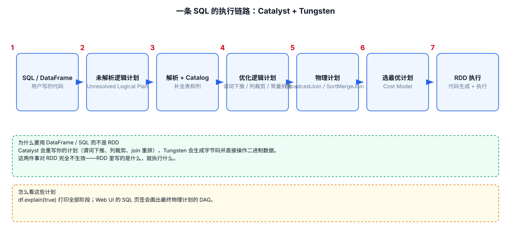

# 11 · 窗口函数与高阶函数

> 窗口函数是 SparkSQL **面试与实战频率最高**的语法：TopN 排名、环比增长、连续登录、开窗累计全靠它。理论一句讲透，重点全在可跑的案例。示例数据来自 `Spark/src/main/data/`。

---



## 11.1 语法：OVER 子句

窗口函数 = 聚合函数/排序函数 + `OVER (PARTITION BY ... ORDER BY ...)`：

```sql
函数() OVER (
    PARTITION BY 分组列    -- 按什么分组开窗（省略 = 全表一个窗）
    ORDER BY  排序列       -- 窗口内按什么排序（位移窗/累计窗必须）
)
```

**与 GROUP BY 的本质区别**：GROUP BY 聚合后**每组只剩一行**；窗口函数聚合后**每行都在**，结果作为新列追加。这是"既要聚合值又不想丢明细"的唯一解法。

| 类别 | 函数 | 用途 |
|---|---|---|
| 排序窗 | `row_number()` | 严格连续序号 1,2,3,4 |
| | `rank()` | 并列同名次，跳号 1,2,2,4 |
| | `dense_rank()` | 并列同名次，不跳号 1,2,2,3 |
| 位移窗 | `lead(col, n)` / `lag(col, n)` | 取窗口内下/上 n 行的值 |
| 聚合窗 | `sum/avg/count/max/min` + OVER | 分组累计、移动平均 |
| 取值窗 | `first_value` / `last_value` / `ntile(n)` | 窗口首末值、分桶 |

---

## 11.2 排序窗：三种序号函数 + TopN

先看三种序号函数的差异（同组内按值排序）：

```sql
-- 值：100, 90, 90, 80
row_number()  →  1, 2, 3, 4    -- 只管顺序，绝不重复（TopN 用它）
rank()        →  1, 2, 2, 4    -- 并列后跳号（成绩排名用）
dense_rank()  →  1, 2, 2, 3    -- 并列不跳号（分层/档位用）
```

### 完整案例：各城市热门商品 Top3（经典面试题）

点击流 `action` join 城市 `city` 和商品 `product`，统计每个城市点击量 Top3 的商品。初始化代码同 [10-SQL语法与内置函数](./10-SQL语法与内置函数.md) 10.1，额外注册商品表：

```java
// 商品表：product_id / product_name / extend_info
Dataset<Row> product = spark.read()
        .option("sep", "\t").option("header", "false")
        .csv("Spark/src/main/data/product_inf0.txt")
        .toDF("product_id", "product_name", "extend_info");
product.createOrReplaceTempView("product");
```

**SQL 版**（推荐，思路最清晰）：

```java
spark.sql(
    "SELECT city_name, product_name, click_cnt " +
    "FROM (" +
    "  SELECT c.city_name, p.product_name, count(*) AS click_cnt, " +
    "         row_number() OVER (PARTITION BY c.city_name " +
    "                            ORDER BY count(*) DESC) AS rn " +
    "  FROM action a " +
    "  JOIN city c ON a.city_id = c.city_id " +
    "  JOIN product p ON a.click_product_id = p.product_id " +
    "  GROUP BY c.city_name, p.product_name" +
    ") t " +
    "WHERE rn <= 3"
).show();
```

**DataFrame DSL 版**（等价写法，Java 里 OVER 用 `Window` 类）：

```java
import static org.apache.spark.sql.functions.*;
import org.apache.spark.sql.expressions.Window;

// 先聚合出 城市×商品 的点击量
Dataset<Row> cnt = action
        .join(city, "city_id")
        .join(product, action.col("click_product_id").equalTo(product.col("product_id")))
        .groupBy("city_name", "product_name")
        .agg(count("*").alias("click_cnt"));

// 再开窗取 Top3
WindowSpec w = Window.partitionBy("city_name").orderBy(desc("click_cnt"));
cnt.withColumn("rn", row_number().over(w))
        .filter(col("rn").lessThanOrEqual(3))
        .drop("rn")
        .show();
```

> **TopN 公式**：`子查询（GROUP BY 聚合 + row_number() OVER (PARTITION BY 分组列 ORDER BY 聚合值 DESC)）→ 外层 WHERE rn <= N`。记住这个骨架，所有"每组前 N"题通杀。

---

## 11.3 位移窗：lead / lag

`lag(col, n)` 取窗口内**上 n 行**的值，`lead(col, n)` 取**下 n 行**的值——比较"前后行"是它独有的能力，GROUP BY 做不到。

```sql
-- 案例一：每日点击量的环比（和昨天比涨了多少）
SELECT dt, click_cnt,
       lag(click_cnt, 1) OVER (ORDER BY dt)                AS yesterday_cnt,
       click_cnt - lag(click_cnt, 1) OVER (ORDER BY dt)    AS diff
FROM (
    SELECT dt, count(*) AS click_cnt
    FROM action
    WHERE click_product_id != '-1'
    GROUP BY dt
) t
ORDER BY dt;
```

```sql
-- 案例二：连续登录 3 天的用户（面试高频）
-- 思路：按用户+日期去重 → lag 取上一次登录日期 → 与当前日期差 1 即连续
SELECT user_id, dt
FROM (
    SELECT DISTINCT cast(user_id AS int) AS user_id, dt,
           lag(dt, 1) OVER (PARTITION BY user_id ORDER BY dt) AS prev_dt
    FROM action
) t
WHERE datediff(dt, prev_dt) = 1     -- 连续两天；连续 N 天再往下推
```

> **注意**：窗口内第一行的 `lag` 没有"上一行"，结果是 null——`datediff(dt, null)` 也是 null，自然被 WHERE 过滤，正好符合需求。

---

## 11.4 聚合窗：分组累计

聚合函数加上 OVER 就变成"**不塌缩**的聚合"——每行都带上组内累计值：

```sql
-- 每个城市的点击量，按天累计（跑-running total）
SELECT c.city_name, a.dt,
       count(*) OVER (PARTITION BY c.city_name ORDER BY a.dt) AS cum_cnt
FROM action a JOIN city c ON a.city_id = c.city_id
WHERE a.click_product_id != '-1';
```

**三个变体**（ORDER BY 决定窗口边界，默认 `RANGE BETWEEN UNBOUNDED PRECEDING AND CURRENT ROW`）：

```sql
sum(x) OVER (PARTITION BY g ORDER BY d)                             -- 从组头累计到当前行
sum(x) OVER (PARTITION BY g)                                        -- 全组总和（每行相同）
sum(x) OVER (PARTITION BY g ORDER BY d ROWS BETWEEN 2 PRECEDING AND CURRENT ROW)  -- 移动3行平均/求和
```

> **RANGE vs ROWS**：默认 RANGE 按**值**划边界（同值同窗），ROWS 按**物理行**划边界。日常累计用默认，滑动窗口显式写 ROWS。

---

## 11.5 高阶函数：操作数组与 Map

Spark 2.4+ 内置了 lambda 风格的高阶函数，直接在 SQL 里操作**数组列**，不用再炸开再聚合：

| 函数 | 作用 | 示例 |
|---|---|---|
| `explode(arr)` | 数组炸成多行（UDTF，见 [09-SparkSQL基础](./09-SparkSQL基础.md) 9.5） | `explode(split(order_product_ids, ','))` |
| `posexplode(arr)` | 炸成多行**带序号** | `posexplode(arr)` → `(pos, col)` |
| `transform(arr, x -> f(x))` | 数组逐元素变换 | `transform(a, x -> x * 2)` |
| `filter(arr, x -> cond)` | 数组按条件过滤 | `filter(a, x -> x > 0)` |
| `exists(arr, x -> cond)` | 是否存在满足条件的元素 | `exists(a, x -> x == 8)` |
| `aggregate(arr, zero, (acc,x) -> f)` | 数组折叠聚合（数组→单值） | `aggregate(a, 0, (acc,x) -> acc + x)` |
| `size(arr)` / `array_contains(arr, v)` | 长度 / 包含判断 | `size(a) > 0` |

```sql
-- 实战：order_product_ids 是逗号分隔的下单商品串
SELECT user_id,
       split(order_product_ids, ',')                          AS order_arr,   -- 字符串→数组
       size(split(order_product_ids, ','))                    AS order_num,   -- 下单件数
       filter(split(order_product_ids, ','),
              x -> x != '\\N' AND x != '')                    AS valid_arr,   -- 过滤空值
       exists(split(order_product_ids, ','), x -> x == '8')   AS has_product8 -- 是否买过商品8
FROM action
WHERE order_product_ids != '\\N'
LIMIT 5;
```

> **与 RDD 对照**：`explode` ≈ flatMap，`transform` ≈ map，`filter` ≈ filter，`aggregate` ≈ reduce——SparkSQL 把 RDD 的函数式武器都搬进了 SQL。

---

## 11.6 本章小结

1. **窗口函数 = 函数 + OVER(PARTITION BY + ORDER BY)**，聚合不塌缩、明细全保留。
2. **TopN 骨架**：子查询聚合 + `row_number() OVER (PARTITION BY 组 ORDER BY 量 DESC)` + 外层 `WHERE rn <= N`。
3. **lead/lag** 比较前后行（环比、连续登录）；**聚合窗** 做分组累计与滑动窗口。
4. **高阶函数** transform/filter/exists/aggregate 在 SQL 里直接操作数组列，是 RDD 函数式的 SQL 化。
5. 三种序号：`row_number` 绝不重复（TopN）、`rank` 并列跳号（排名）、`dense_rank` 并列不跳（分层）。
