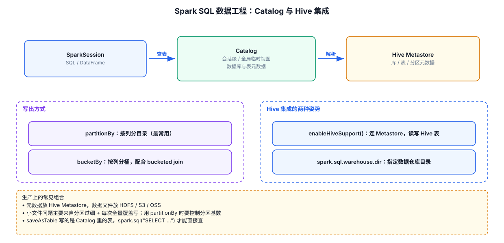

# 12 · SparkSQL 数据工程与 Hive 集成

> 前面章节都在"读和算"，本章讲**写**：write 的 4 种模式、分区/分桶落盘、saveAsTable 与 Catalog、Hive 集成。这是从"会查询"到"会写生产作业"的分水岭。示例可直接运行。

---



## 12.1 write 的 4 种 mode

`df.write().mode(x)` 决定**目标路径/表已存在时怎么办**——用错会丢数据：

| mode | 目标已存在时的行为 | 典型用途 |
|---|---|---|
| `append`（默认） | 追加，不碰旧数据 | 增量写入 |
| `overwrite` | **先删全部旧数据**，再写 | 全量覆盖（每日重跑） |
| `errorIfExists` | 报错（默认之一） | 防误写 |
| `ignore` | 静默跳过，什么都不做 | 幂等写入（已生成就不重算） |

```java
Dataset<Row> df = spark.read().json("Spark/src/main/data/user.json");

// 四种模式写出 Parquet
df.write().mode("overwrite").parquet("output/mode_demo");   // 重跑安全：先清空再写
df.write().mode("append").parquet("output/mode_demo");      // 每次追加一批
df.write().mode("errorIfExists").parquet("output/mode_demo");  // 第二次跑必报错
df.write().mode("ignore").parquet("output/mode_demo");      // 已存在就跳过
```

> **踩坑提醒**：`saveAsTextFile`（04 章）没有 mode 参数，目录存在直接报错；DataFrame 的 write 才有 mode。**重跑作业用 overwrite 最省心**。

## 12.2 分区写出：partitionBy

`partitionBy` 把数据按列值切成**子目录**，读取时谓词下推只扫匹配的分区：

```java
// 按城市分区写出（用 10 章初始化的 action + city）
action.join(city, "city_id")
        .select("dt", "user_id", "click_product_id", "city_name")
        .write()
        .mode("overwrite")
        .partitionBy("city_name")          // 分区列：从数据列变成目录
        .parquet("output/partitioned");
```

落盘后的目录结构：

```
output/partitioned/
├── city_name=上海/
│   └── part-00000-....snappy.parquet
├── city_name=北京/
│   └── part-00000-....snappy.parquet
├── city_name=深圳/
│   └── ...
```

```java
// 读取时自动分区裁剪：只扫北京目录，其他城市根本不读
spark.read().parquet("output/partitioned")
        .filter(col("city_name").equalTo("北京"))
        .show();
```

> **知识点**：
> - 分区列**不再存在文件里**，只出现在目录名上，读回来 Spark 自动还原成列。
> - 分区列选**查询频率高、基数适中**的列（dt、city）；user_id 这种千万级的列做分区 = 小文件灾难（见 [08-数据倾斜专题](./08-数据倾斜专题.md) 8.4.6）。
> - Hive 动态分区写入的倾斜问题见 08 章 8.4.5。

## 12.3 分桶写出：bucketBy

`partitionBy` 按值切目录，`bucketBy` 按 **hash(列) % 桶数** 切文件——数据分布均匀，是 **Bucket Join 免 shuffle** 的前提（见 [08-数据倾斜专题](./08-数据倾斜专题.md) 8.4.1）：

```java
// 按 user_id 分 16 个桶（bucketBy 只能配合 saveAsTable 使用）
action.selectExpr("cast(user_id as int) AS user_id",
                  "click_product_id", "dt")
        .write()
        .mode("overwrite")
        .bucketBy(16, "user_id")           // 16 个桶，按 user_id 的 hash 分
        .sortBy("user_id")                 // 桶内按 user_id 排序，读更快
        .saveAsTable("bucketed_action");

spark.sql("SELECT * FROM bucketed_action WHERE user_id = 95").show();
```

**partitionBy vs bucketBy 对比**：

| 对比项 | partitionBy | bucketBy |
|---|---|---|
| 切分方式 | 按列**值** → 子目录 | 按 hash(列) % n → 文件 |
| 每份数据量 | 不均（北京多、西宁少） | **均匀**（hash 散列） |
| 分区数上限 | 列的基数 | 桶数自定 |
| 主要用途 | 读取裁剪（少扫数据） | **join 免 shuffle** + 高效点查 |
| 目录形态 | `city_name=北京/` | 同目录下 n 个文件 |

## 12.4 saveAsTable 与 Catalog

`saveAsTable` 把 DataFrame 存成**表**（元数据进 Catalog），之后直接用表名查：

```java
// 托管表（managed table）：数据存在 Spark 仓库目录（默认 ./spark-warehouse）
df.write().mode("overwrite").saveAsTable("user_managed");

// 外部表（external table）：指定 path，数据归你管，删表不删数据
df.write().mode("overwrite")
        .option("path", "output/user_external")
        .saveAsTable("user_external");

// SQL 也能建表
spark.sql("CREATE TABLE IF NOT EXISTS user_sql USING parquet AS SELECT * FROM user");

// ---- Catalog API：查库、查表、查函数 ----
spark.catalog().listDatabases().show();     // default、global_temp
spark.catalog().listTables().show();        // 刚建的所有表
spark.catalog().listColumns("user_managed").show();   // 表结构

// 删表：托管表连数据一起删，外部表只删元数据
spark.sql("DROP TABLE user_managed");       // 数据也没了
spark.sql("DROP TABLE user_external");      // output/user_external 还在
```

| 对比项 | 托管表 | 外部表 |
|---|---|---|
| 数据位置 | Spark 仓库目录 | 自定义 path |
| `DROP TABLE` | **元数据+数据全删** | 只删元数据，数据保留 |
| 适用场景 | 中间结果、临时分析 | 共享数据、多人/多任务使用 |

## 12.5 Hive 集成

生产环境的表都存在 **Hive Metastore** 里，Spark 一行配置接入：

```java
SparkSession spark = SparkSession
        .builder()
        .appName("HiveDemo")
        .config("spark.driver.host", "localhost")
        .master("local[*]")
        .enableHiveSupport()        // ← 开启 Hive 支持
        .getOrCreate();

spark.sql("SHOW DATABASES").show();
spark.sql("SELECT * FROM hive_db.hive_table LIMIT 10").show();
```

**接入条件**：classpath 里有 `hive-site.xml`（指向 metastore 地址）+ `spark-hive` 依赖。本项目未配 Hive，此节作为概念了解：

| 概念 | 要点 |
|---|---|
| `enableHiveSupport()` | 让 Spark 直接读写 Hive 表，复用 metastore 元数据 |
| Hive 内表/外表 | 同 12.4 的托管/外部表概念，Hive 语法：`LOCATION` 指定即外表 |
| 动态分区写入 | `INSERT OVERWRITE TABLE t PARTITION(dt)`，配置与倾斜治理见 [08-数据倾斜专题](./08-数据倾斜专题.md) 8.4.5 |
| Parquet/ORC 表 | 生产标配列存格式（特性见 [02-Spark数据导入与数据结构](./02-Spark数据导入与数据结构.md) Parquet 一节） |
| Spark 读写速度 | 远快于 Hive on MR，但底层格式（ORC/Parquet + 分区 + 分桶）是共用的 |

## 12.6 本章小结

1. **write 4 种 mode**：重跑作业用 `overwrite`，增量用 `append`，幂等用 `ignore`。
2. **partitionBy** 按值切目录（读取裁剪），**bucketBy** 按 hash 切文件（join 免 shuffle + 均匀分布）。
3. **saveAsTable** 进 Catalog；托管表删表删数据，外部表只删元数据。
4. **Hive 集成**一行 `enableHiveSupport()`，本质是共享 metastore 与存储格式。
