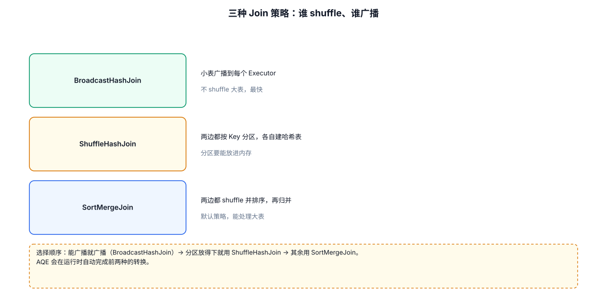
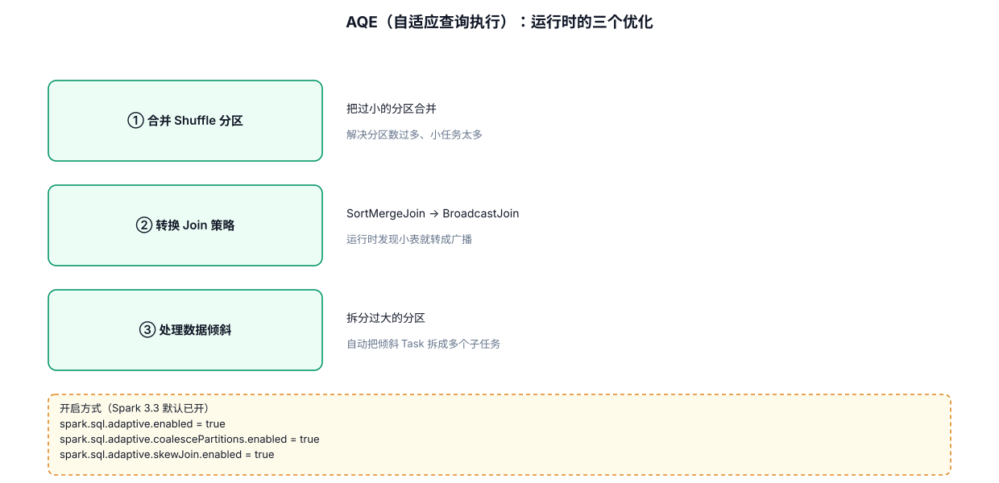
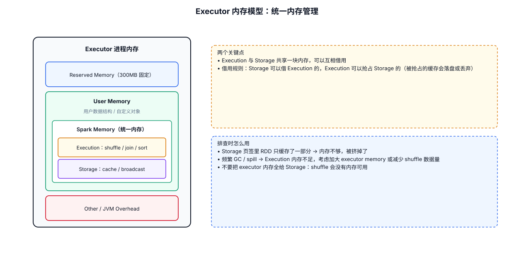

# 13 · SparkSQL 原理与性能：Catalyst 与执行计划

> 一句话理论：**Catalyst 是 SparkSQL 的优化引擎，把 SQL/DSL 翻译成优化过的物理执行计划**。本章讲它的流程、两大经典优化（谓词下推/列裁剪）和 explain 的读法——这是 SQL 调优的工具链入口。

---







## 13.1 Catalyst 优化流程

一段 SQL 从文字到执行，走五步：

```
SQL / DataFrame DSL
        │ ① 解析 Parse：语法分析，生成"未解析的逻辑计划"（Unresolved）
        ▼
   逻辑计划（Unresolved LogicalPlan）
        │ ② 分析 Analyze：结合 Catalog 里的表/列信息，绑定真实类型
        ▼
   逻辑计划（Analyzed LogicalPlan）
        │ ③ 优化 Optimize：套用规则库（RBO），谓词下推、列裁剪、常量折叠…
        ▼
   优化后逻辑计划（Optimized LogicalPlan）
        │ ④ 转物理计划 Physical Plan：选择具体算子（HashJoin/SortMergeJoin/BroadcastJoin…）
        ▼
   物理计划 + ⑤ 代码生成（Tungsten 整阶段代码生成，生成 JVM 字节码）
        ▼
   RDD 执行（Stage/Task，见 07 章与 15 章 WebUI）
```

> **与 RDD 的关系**：SparkSQL 最终还是跑在 RDD 上——Catalyst 的价值是**自动**把"声明式"的 SQL 优化成接近手写调优 RDD 的执行计划，这就是 DataFrame 比 RDD 快的根本原因（02 章对比表的伏笔在此收口）。

## 13.2 两大经典优化：谓词下推与列裁剪

**谓词下推（Predicate Pushdown）**：把 WHERE 尽量推到**最靠近数据源**的地方，先过滤再读。
**列裁剪（Column Pruning）**：只读 SQL 用到的列，其余列根本不从文件里解析。

用一条查询看效果：

```java
// 读 18 万行点击流，只想要北京年龄>15 的用户名
Dataset<Row> df = spark.read().json("Spark/src/main/data/user.json");
df.createOrReplaceTempView("user");

spark.sql("SELECT name FROM user WHERE age > 15").explain();
```

```
== Physical Plan ==
*(1) Project [name#5]                              ← 列裁剪：只投影 name 一列
+- *(1) Filter (age#6 > 15)                        ← 过滤被保留在扫描侧
   +- FileScan json [age#6,name#5]                 ← 但 JSON 没法只读一列，需整行解析
       PushedFilters: [GreaterThan(age,15)]        ← 谓词下推：过滤条件推给了数据源
       ReadSchema: struct<age:bigint,name:string>
```

换成 Parquet（列存）效果更彻底：

```java
df.write().mode("overwrite").parquet("output/user_parquet");
spark.read().parquet("output/user_parquet")
        .filter(col("age").gt(15))
        .select("name")
        .explain();
// FileScan parquet [name] ← 只读 name 列的磁盘数据，age 靠列统计直接跳过
```

> **结论**：Parquet/ORC 列存 + 谓词下推 + 列裁剪三件套，是生产表用列存格式的根本原因（呼应 [02-Spark数据导入与数据结构](./02-Spark数据导入与数据结构.md) Parquet 一节、[12-SparkSQL数据工程与Hive](./12-SparkSQL数据工程与Hive.md)）。

## 13.3 explain：读懂执行计划

```java
df.explain();              // 物理计划（最常用）
df.explain(true);          // 全套：解析/分析/优化/物理计划全打印
spark.sql("EXPLAIN EXTENDED SELECT ...").show(false);   // SQL 写法
```

**读计划的三个重点**：

| 看什么 | 判断什么 |
|---|---|
| `FileScan ... PushedFilters` | 过滤有没有下推到数据源 |
| `BroadcastHashJoin` vs `SortMergeJoin` | 小表有没有被广播（BroadcastHashJoin = 不 shuffle，见 08 章方案五） |
| `Exchange` 节点 | 发生 shuffle 的位置——**每个 Exchange = 一条 Stage 边界**（对应 15 章 WebUI SQL 页 DAG 图里的 Exchange 蓝色节点） |

```java
// 一个 Exchange 实例：group by 必然产生 shuffle
spark.sql(
    "SELECT city_id, count(*) FROM action GROUP BY city_id"
).explain();
// 输出里会看到：
//   HashAggregate(key=[city_id], ...)            ← 最终聚合
//   +- Exchange hashpartitioning(city_id, 200)   ← shuffle！默认 200 个分区
//      +- HashAggregate(key=[city_id], ...)      ← map 端部分聚合（预聚合）
```

> **实战闭环**：explain 看计划（代码层面）→ 提交运行 → [15-SparkWebUI](./15-SparkWebUI.md) SQL 页看真实 DAG 和耗时（运行层面）→ 发现倾斜回 [08-数据倾斜专题](./08-数据倾斜专题.md) 对症下药。

## 13.4 AQE：运行时的自动优化

静态计划（explain 看到的）在**编译时**生成，拿不到真实数据量。**AQE（Adaptive Query Execution）**在运行时用真实统计动态改计划，做三件事（详细参数见 [08-数据倾斜专题](./08-数据倾斜专题.md) 8.4.6）：

1. **合并小分区**——治小文件；
2. **拆分倾斜分区**——治倾斜 join；
3. **join 策略升级**——发现一边比预期小，SortMergeJoin 动态转 BroadcastHashJoin。

```java
// 本项目学习阶段建议常开（Spark 3.2+ 默认已开）
spark.conf().set("spark.sql.adaptive.enabled", "true");
```

> **一句话**：Catalyst 负责"算得聪明"（编译期优化），AQE 负责"边跑边改"（运行期优化），两者叠加是 Spark 3.x SQL 性能的完整答案。

## 13.5 本章小结

1. **Catalyst 五步**：解析 → 分析 → 优化（RBO）→ 物理计划 → 代码生成，最终仍跑在 RDD 上。
2. **谓词下推 + 列裁剪**是规则库的两大主力，列存格式让它们发挥到极致。
3. **explain 三看**：PushedFilters、join 类型、Exchange 位置（= Stage 边界）。
4. **调优工具链闭环**：explain（计划）→ WebUI（运行）→ 08 章（倾斜治理）。
