# 15 · Spark Web UI 运维界面详解

> 提交作业后（见 01 章 1.4 作业提交），如何监控运行情况、排查性能问题？答案就是 **Spark Web UI**——一个随应用启动的内置 Web 监控界面。
>
> **入口**：本地/`client` 模式默认 `http://localhost:4040`；`cluster` 模式通过 YARN 的 ApplicationMaster 跳转。作业运行期间实时更新，作业结束后仍可查看历史。
>
> 本文所有截图都来自真实运行的 Spark 3.3.1 应用（standalone 集群模式，1 Driver + 3 Executor），
> 不是示意图。复现用的演示程序与启动参数见文末 15.11。

---

## 15.1 认识 Web UI：导航栏与整体布局

打开 Web UI，顶部是一条**深色导航栏**，固定包含 6 个标签页：

| 标签页 | 路径 | 作用 | 什么时候看 |
|---|---|---|---|
| **Jobs** | `/jobs/` | 所有 Job（作业）列表 | 总览运行了几个 Job、耗时 |
| **Stages** | `/stages/` | 所有 Stage（阶段）列表 | 定位 shuffle、看数据量 |
| **Storage** | `/storage/` | RDD 缓存情况 | 检查 `cache`/`persist` 是否生效 |
| **Environment** | `/environment/` | 运行时环境与配置 | 排查配置/版本问题 |
| **Executors** | `/executors/` | 每个 Executor 的资源和任务 | 查数据倾斜、内存、GC |
| **SQL / DataFrame** | `/SQL/` | SparkSQL 查询的 DAG | 看 SQL 执行计划 |
| **Structured Streaming** | `/StreamingQuery/` | 流查询的运行指标 | 只有存在流查询时才出现 |

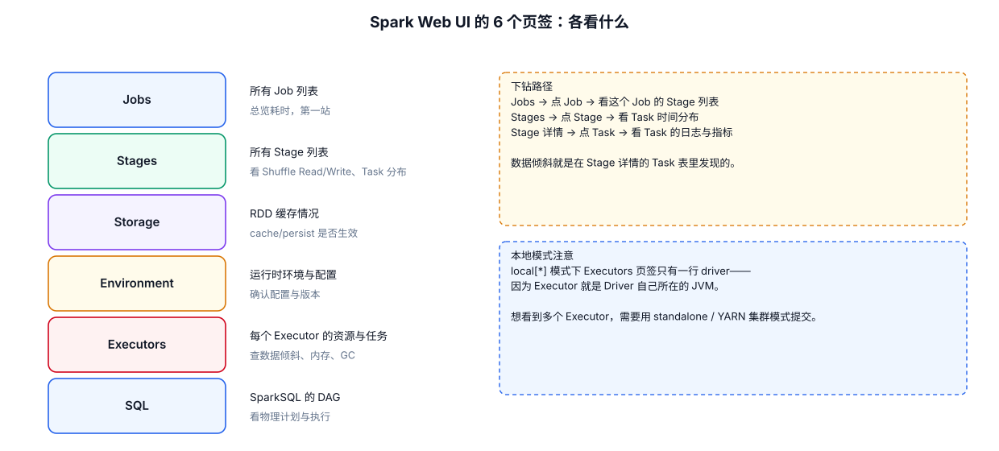

> 核心记忆：**每个行动算子 = 一个 Job**（同 04 章 4.0 节），Web UI 的 Jobs 页面就是把你程序里触发的所有行动算子列出来。

---

## 15.2 Jobs 页面：作业总览

Jobs 页面列出应用运行的所有 Job，是排查问题的**第一站**。

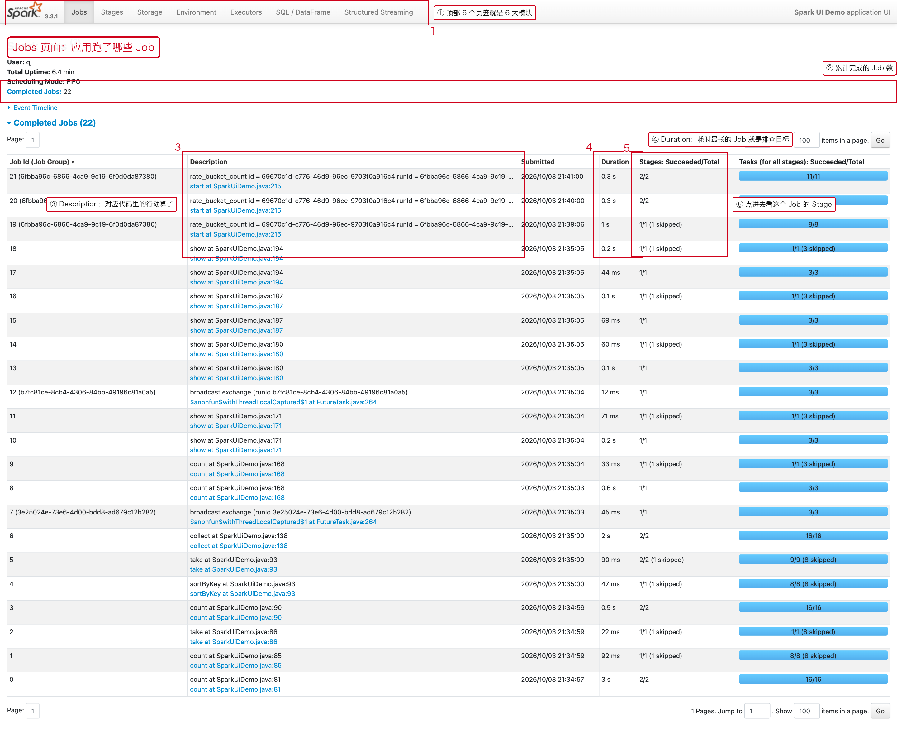

| 关注点 | 说明 |
|---|---|
| ① 顶部导航 | 6 个页签，互相跳转 |
| ② `Completed Jobs` | 累计完成的 Job 数；如果远大于你代码里的行动算子数，说明有流查询在不断产生微批 |
| ③ `Description` | **直接对应代码里的行动算子与行号**，例如 `collect at SparkUiDemo.java:138` |
| ④ `Duration` | 耗时最长的 Job 就是优化目标 |
| ⑤ `Stages: Succeeded/Total` | 点进去下钻到该 Job 的 Stage 详情 |

页面往下还有两块内容：

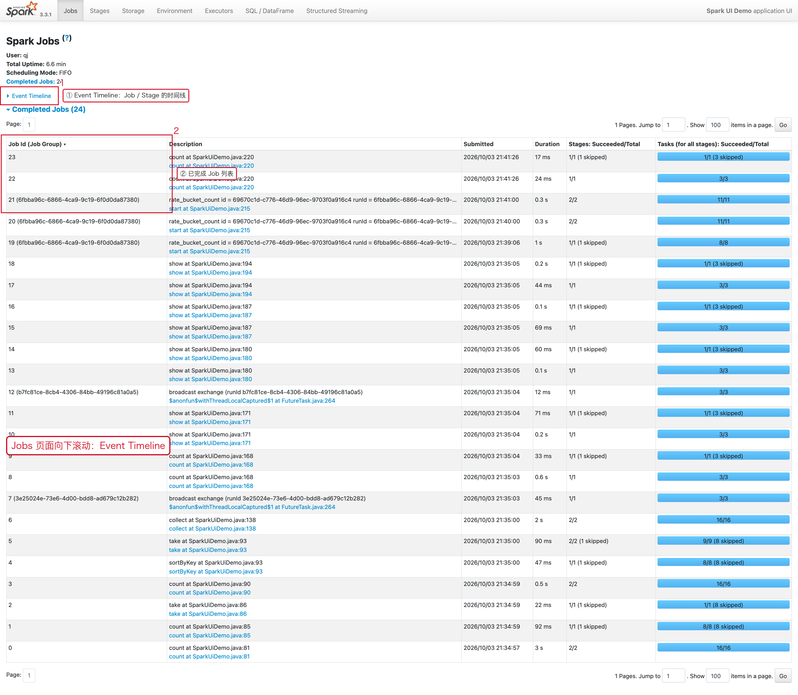

- **Event Timeline**：把每个 Job / Stage 的开始结束时间画在时间轴上，
  一眼能看出「串行执行还是并发执行」「哪段时间在等」。
- **Completed Jobs 列表**：所有已结束 Job 的汇总表。

> **排查心法**：哪个 Job 耗时最长 → 点进去看它的 Stages → 再定位到具体 Stage 的 shuffle。

---

## 15.3 Job 详情页：DAG 与 Stage 列表

点 Job 的 `Description` 进入 Job 详情：

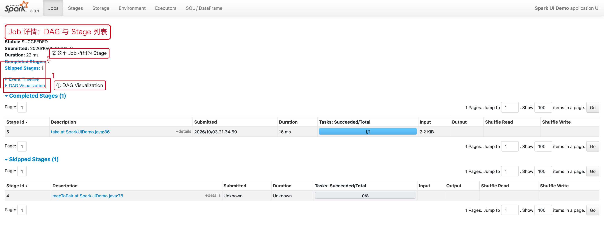

- **① DAG Visualization**：这个 Job 的计算图，方框是 RDD，箭头是依赖。
  图上出现**明显的分层**就说明中间有 Shuffle（宽依赖）。
- **② Stage 列表**：这个 Job 被切成了几个 Stage，每个 Stage 的耗时与输入量。

**Stage 数量 = 宽依赖数量 + 1**，所以「Stage 越多 = Shuffle 越多」。

---

## 15.4 Stages 页面：定位 shuffle 与数据量

Stages 页面展示所有 Stage，最关键的列是 **Shuffle Read / Shuffle Write**。

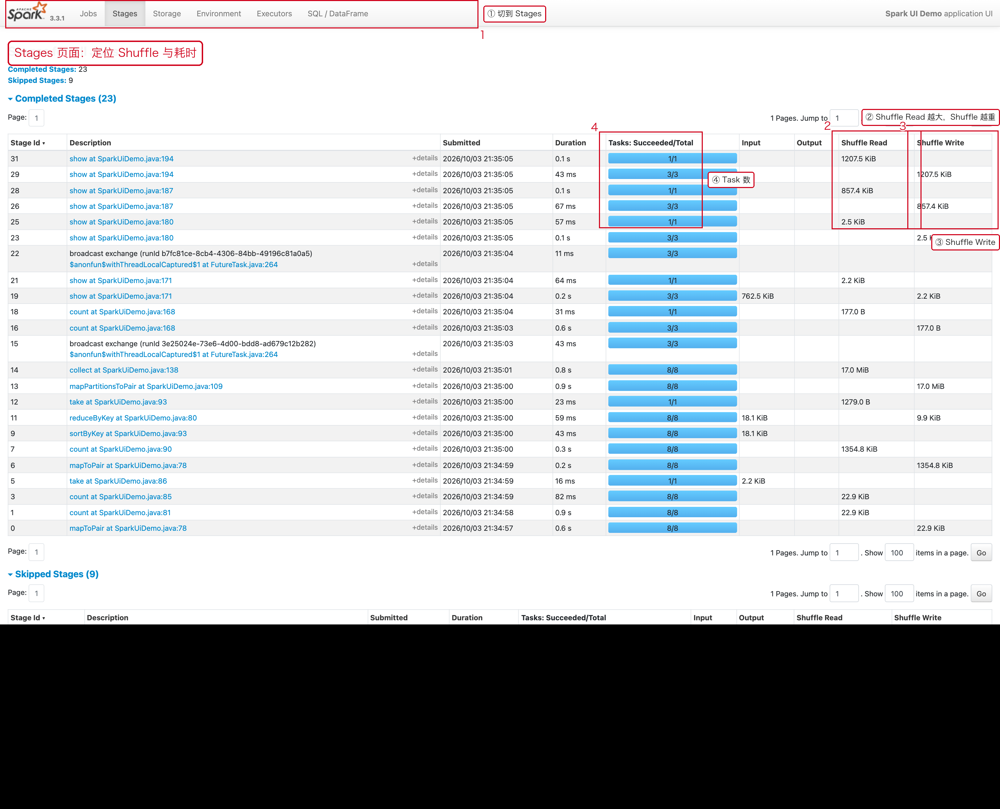

| 关注点 | 说明 |
|---|---|
| ① 顶部导航 | 切到 Stages |
| ② `Shuffle Read` | **越大说明 shuffle 越重**，是数据倾斜、性能瓶颈的排查重点 |
| ③ `Shuffle Write` | Map 端写出的数据量 |
| ④ `Tasks: Succeeded/Total` | 例如 `8/8` 表示 8 个 Task 全部成功 |

点某个 Stage 进入详情页，这是**发现数据倾斜的地方**：

---

## 15.5 Stage 详情页：数据倾斜在这里现形

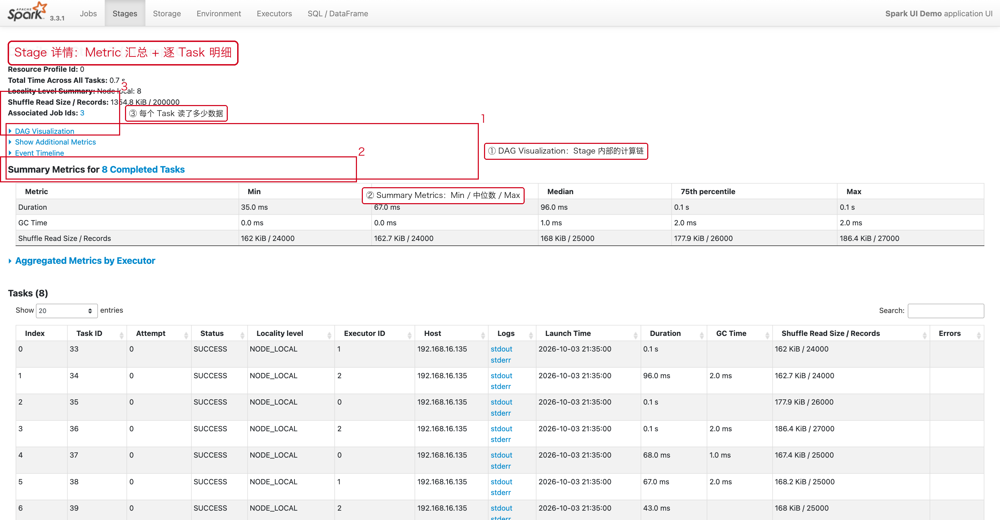

Stage 详情页分三块：

1. **① DAG Visualization**：Stage 内部的计算链。
2. **② Summary Metrics**：把所有 Task 的指标按 `Min / 25% / Median / 75% / Max` 汇总。
3. **③ 逐 Task 明细表**：每个 Task 的耗时、GC、Shuffle Read、是否成功。

### 关键判据：看 Max 与 Median 的差距

下面这个 Stage 就是一个**真实的倾斜现场**：


```text
Duration            Min 73ms  /  Median 90ms  /  Max 0.6s      → Max 是中位数的 6 倍
Shuffle Read Size   Min 300KB /  Median 322KB /  Max 14.8 MiB   → Max 是 Min 的 50 倍
Shuffle Read Records Min 4.8 万 / Max 365 万条                   → 一个 Task 读走了 90% 的数据
```

**判据：**

```text
Max ÷ Median < 2      → 分布均匀，正常
Max ÷ Median > 3~4    → 明显倾斜，要处理
Max ÷ Median > 10     → 严重倾斜，Stage 的耗时完全由这一个 Task 决定
```

> 同一张表里点 Task 的 `stdout / stderr` 还能直接看那个慢 Task 的日志。
> 处理方案见 [08 数据倾斜专题](./08-数据倾斜专题.md)。

---

## 15.6 SQL 页面：SparkSQL 执行计划（DAG）

SQL 页面把每个 SQL 查询 / DataFrame 操作列出来。

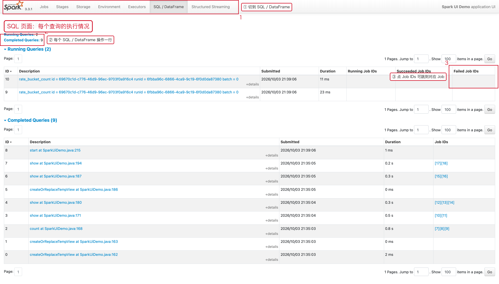

点任意一条查询的 `+details`，展开它的物理计划 DAG：

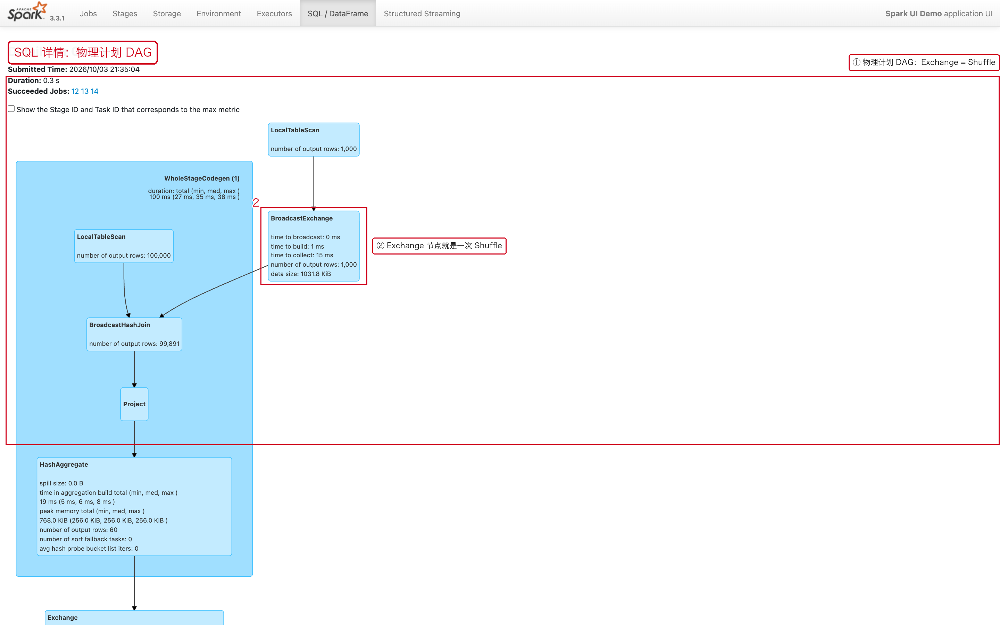

**怎么看这张图：**

```text
Exchange 节点            → 一次 Shuffle（性能瓶颈的头号信号）
BroadcastExchange        → 小表广播（好事，没有大表 Shuffle）
HashAggregate            → 聚合
SortMergeJoin            → 走的是排序合并 join
AdaptiveSparkPlan        → 开启了 AQE
```

> 节点左侧的 `*` 表示该节点启用了全阶段代码生成（WholeStageCodegen），是好事。

---

## 15.7 Executors 页面：查倾斜与资源

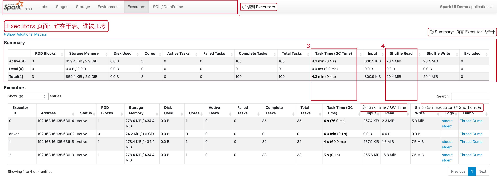

页面上有两个表：

**① Summary（所有 Executor 的合计）**

| 列 | 含义 |
|---|---|
| `RDD Blocks` | 缓存了多少个 RDD Block |
| `Storage Memory` | 已用 / 总可用 |
| `Task Time (GC Time)` | 总任务时间与 GC 时间，**GC 占比高说明内存压力大** |
| `Shuffle Read / Write` | 这个 Executor 承担的 shuffle 量 |
| `Excluded` | 被排除的 Executor 数（出现非 0 说明有节点被拉黑） |

**② Executors（逐实例明细）**：每行一个 Executor，可以看
`Cores / Active Tasks / Failed Tasks / Task Time / Input / Shuffle Read / Write`，
最右边还有 **Logs（stdout、stderr）** 和 **Thread Dump** 入口。

| 关注点 | 说明 |
|---|---|
| ③ `Task Time (GC Time)` | 例如 `5 s (0.1 s)` 表示总耗时 5 秒、其中 GC 0.1 秒 |
| ④ `Shuffle Read` 分布不均 | 某个 Executor 的 Shuffle Read 远高于其他 → 倾斜 |

> **本地模式的坑**：`local[*]` 提交时，Executors 页签里**只有一行 driver**，
> 因为 Executor 就是 Driver 自己所在的 JVM。想看到多个 Executor，
> 需要用 standalone / YARN 集群模式提交（本文截图就是这样得到的）。

---

## 15.8 Storage 页面：缓存是否生效

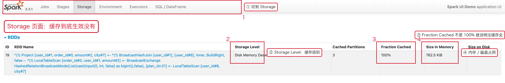

**怎么看：**

- **只有 `cache()` / `persist()` 过的 RDD 才会出现在这里**。
  如果某个 RDD 不在列表里，说明缓存没生效（漏写 `cache()`，或者已经被淘汰）。
- `② Storage Level`：缓存级别，例如 `Disk Memory Deserialized 1x Replicated`。
- `③ Fraction Cached`：**缓存比例**。不是 100% 就说明内存不够，只缓存了一部分。
- `④ Size in Memory / Size on Disk`：内存与磁盘占用。

> `Fraction Cached` 长期低于 100% 时，要么加 `spark.memory.storageFraction`，
> 要么换更省内存的序列化级别（`MEMORY_AND_DISK_SER`）。原理见 [spark-memory-model.svg](./images/spark-memory-model.svg) 与 13 章。

---

## 15.9 Environment 页面：配置与版本

Environment 页面列出运行时环境和所有 Spark 配置参数，是排查「配置不生效、版本不对」的第一现场。

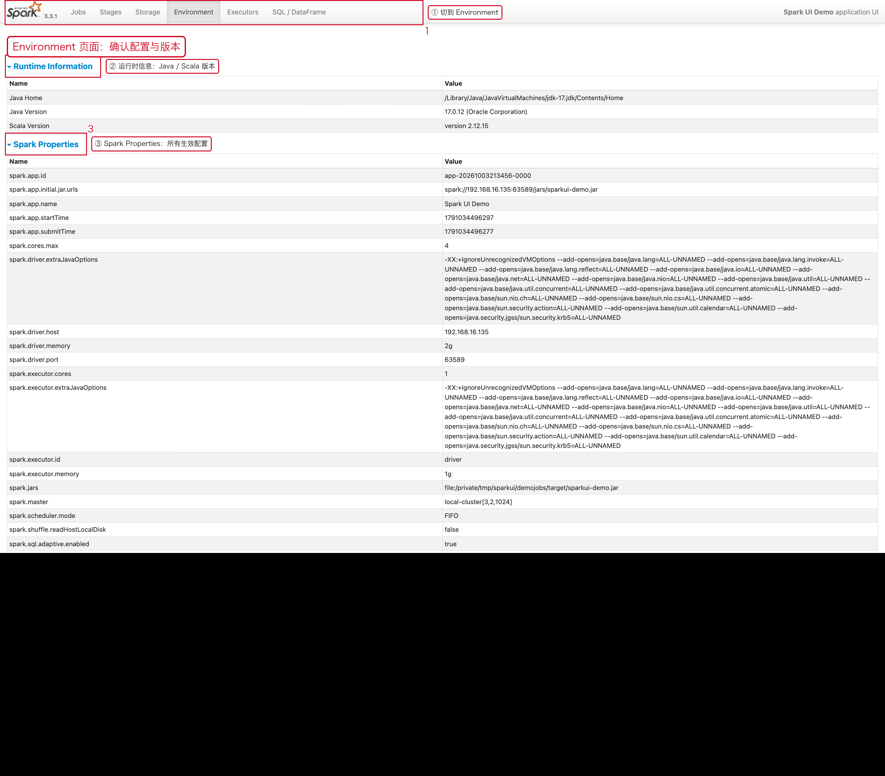

**怎么看：**

- **② Runtime Information**：Java Home / Java Version / Scala Version，
  用于确认「Spark 版本 ↔ Scala 版本 ↔ Java 版本」是否匹配（见 01 章 1.3）。
- **③ Spark Properties**：提交时用 `--conf` 传的参数、以及程序里 `SparkConf.set()` 的值都会出现在这里，
  可据此验证配置是否真的生效。

常见要核对的项：

```text
spark.app.name
spark.master
spark.executor.cores / spark.executor.memory
spark.sql.shuffle.partitions
spark.sql.adaptive.enabled
spark.default.parallelism
```

---

## 15.10 Structured Streaming 页面：流查询指标

只要应用里有**活跃的流查询**，导航栏就会多出 `Structured Streaming` 页签。

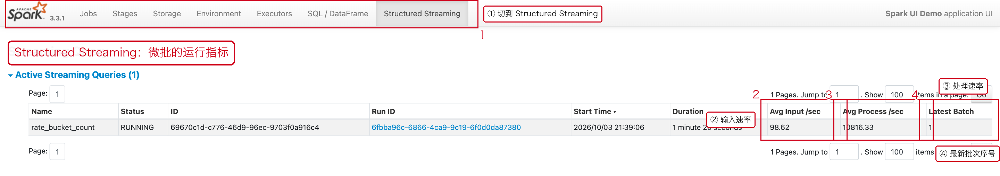

| 列 | 含义 |
|---|---|
| `Status` | RUNNING / FINISHED |
| `Avg Input /sec` | ② 平均输入速率（条/秒） |
| `Avg Process /sec` | ③ 平均处理速率（条/秒） |
| `Latest Batch` | ④ 最新批次号；点进去可以看每一批的处理时间与调度延迟 |

**判断流查询健康度：**

```text
Avg Input > Avg Process  → 处理跟不上，批次会越积越多（消费延迟持续增大）
Latest Batch 长时间不动  → 批次卡住，去 Jobs 页签看对应微批的状态
```

---

## 15.11 复现本文截图

截图来自一个刻意制造了各种现场的演示程序（standalone 集群，1 Driver + 3 Executor）：

```bash
# 1. 启动 Spark standalone 集群
$SPARK_HOME/sbin/start-master.sh
$SPARK_HOME/sbin/start-worker.sh spark://localhost:7077

# 2. 提交演示程序（4 个 Executor，每个 1 Core）
$SPARK_HOME/bin/spark-submit \
  --master spark://localhost:7077 \
  --name "Spark UI Demo" \
  --class demo.SparkUiDemo \
  --executor-cores 1 --total-executor-cores 4 \
  --executor-memory 1g --driver-memory 3g \
  --conf spark.sql.shuffle.partitions=8 \
  --conf spark.sql.adaptive.enabled=true \
  sparkui-demo.jar

# 3. 打开 http://localhost:4040
```

演示程序依次制造：RDD shuffle + cache、热点 Key 倾斜（`groupByKey`）、
DataFrame join、Spark SQL 聚合与窗口函数、Structured Streaming 微批。

---

## 15.12 Web UI 排查速查表

| 症状 | 去哪里看 | 看什么 |
|---|---|---|
| 作业整体慢 | Jobs → 找耗时最长的 Job | Duration 列 |
| 某步特别慢 | Stages → 找耗时最长 Stage | Duration + Shuffle 量 |
| **数据倾斜** | Stage 详情 → Summary Metrics | **Max ÷ Median 是否 > 3** |
| SQL 慢 | SQL → DAG 图 | Exchange（shuffle）节点数量 |
| 任务不均衡 | Executors | Task Time / Shuffle Read 是否相差大 |
| 缓存没生效 | Storage | RDD 是否在列表里、Fraction Cached |
| 配置/版本不对 | Environment | Spark Properties 与实际值 |
| 流查询积压 | Structured Streaming | Avg Input 与 Avg Process 的对比 |

**下钻路径**（记住这一条就够）：

```text
Jobs → 点 Job → 看 Stage 列表 → 点 Stage → 看 Task 明细
     → 找 Max 远大于 Median 的那个 Task → 这就是瓶颈
```

---

## 15.13 小结

1. Web UI 有 6 个核心页签：Jobs / Stages / Storage / Environment / Executors / SQL（有流查询时再加 Structured Streaming）。
2. **Jobs = 行动算子**，是总览入口；**Stages** 定位 shuffle；**SQL** 看执行计划 DAG。
3. **Exchange = shuffle**，是性能瓶颈信号；**Task 的 Max ÷ Median > 3 = 数据倾斜**。
4. 排查顺序：Jobs → Stages → Stage 详情 / Task 明细，或 SQL → DAG。
5. 本地模式只有一个 driver executor，要模拟集群效果请用 standalone / YARN 提交。
6. 结合 [07 Shuffle 专题](./07-Shuffle专题.md) 与 [08 数据倾斜专题](./08-数据倾斜专题.md) 一起看效果最佳。
